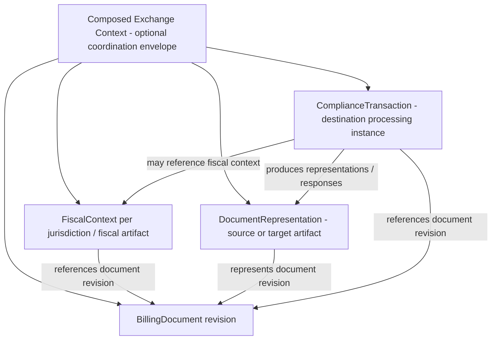

# CTC-002 — Semantic Aggregate Boundaries

**Date:** 2026-10-19  
**Status:** Draft for review / not approved  
**Task:** CTC-002 (P0)  
**Leading hypothesis:** Composed semantic contract, as explicitly directed following CTC-001.

## Scope and evidence

Define ownership, lifecycle independence, identity, multiplicity, and revision references for four candidate concepts. Do not derive physical database tables or APIs.

Source versions: SemanticDocument Entity Specification v1.0 (2026-09-07); CTC Transformation Framework v1.1; Global Semantic Billing Model v0.3; Relational Data Model v0.3; CTC-001 reconciliation review (2026-10-19). External fixture validation has **not** been completed.

## Proposed boundary map

The arrows describe **candidate logical associations**, not approved aggregate containment or foreign keys.

## Candidate aggregate responsibilities

| Concept | Owns | Does not own | Candidate multiplicity / identity |
|---|---|---|---|
| BillingDocument | Commercial parties, lines, signed amounts, taxes, totals, references, payment and supply meaning | Authority submission status, raw format profile, delivery attempts | One commercial document with potentially multiple immutable semantic revisions; document number is not globally unique |
| FiscalContext | Fiscal classification, tax point, party fiscal attributes, fiscal identifiers, governed local extensions | Transport retries, delivery status | Zero to many jurisdiction/regime contexts per billing revision **to test**; newer relational v0.3 assumes 0..1, so this is an open conflict |
| DocumentRepresentation | Original or emitted serialization, format family/version, mapping version, content hash, artifact pointer | Canonical business meaning and authority state | Many per billing revision, potentially one per outbound target or source revision |
| ComplianceTransaction | Destination/regime processing, attempts, lifecycle events, authority responses, validation/evidence references | Mutable edits to commercial invoice values | Zero to many per immutable billing revision; distinguish transaction from attempt and external message |
| Optional exchange context | Correlation of these objects in one integration workflow | Business and fiscal fields duplicated from owned aggregates | Envelope vs reference-only coordination remains open |

## Key architecture challenges

1. **FiscalContext cardinality conflict:** v0.3 relational draft models 0..1 per BillingDocument; multi-destination routing may need multiple fiscal contexts. Test whether jurisdiction-specific fiscal context belongs to a document revision, a fiscal artifact, or a compliance execution.
2. **Revision identity:** Separate commercial document identity, semantic revision identity, fiscal identity, representation hash and submission/attempt identity. Avoid using invoice number as a global primary key.
3. **Source and target provenance:** Representation must reference the exact semantic revision and immutable mapping/profile versions. A new target serialization must not mutate the source representation.
4. **Authority-generated fiscal artifacts:** Decide whether post-clearance UUID, signed payload and authorization receipt update a fiscal artifact or append separate immutable evidence. Do not conflate response with document semantics.
5. **Tax model boundary:** Multi-regime tax is commercial/fiscal meaning, not automatically processing state; defer detailed field synthesis to CTC-004.
6. **Partial / invalid source inputs:** Candidate core should not require invented cities, identifiers or units simply to pass global cardinality. Distinguish ingestion draft, semantically complete document and target-profile-ready document.
7. **Corrections:** Credit notes and replacements are new related business/fiscal documents, not merely mutable revisions of a previously issued invoice.
8. **Non-billing documents:** A future generic envelope might support other fiscal document types; do not stretch BillingDocument into every tax document.

## Candidate identity vocabulary (unapproved)

- `documentId`: stable internal identity of a commercial document (tenant-scoped).
- `documentRevisionId`: immutable semantic snapshot identity.
- `fiscalContextId`: identity of fiscal context associated with a revision and jurisdiction/regime.
- `representationId`: immutable source/target artifact identity and hash.
- `complianceTransactionId`: independently tracked obligation/destination workflow identity.
- `submissionAttemptId`: one actual external submission attempt.
- `externalReference`: typed authority/network identifier with issuer and jurisdiction, not a universal document ID.

These names are working labels, not approved schema paths.

## Scenarios required before approval

| Scenario | Boundary tested | Expected evidence |
|---|---|---|
| ERP invoice sent to two distinct networks | One document revision to many compliance transactions | Two destination profiles and independently evolving statuses |
| Authority rejects then accepts on corrected resubmission | Transaction vs attempt vs document revision | Correlation and immutable history without overwriting originals |
| CFDI fiscal UUID assigned after certification | Fiscal artifact vs authority response | Authority identifier preserved and source/compliance semantics separated |
| French GROUP/DETAIL invoice with negative lines | Commercial core independence | Signed values, hierarchy and correct reconciliation |
| Credit note against cleared invoice | Document relationship vs revision | Separate document identity linked to original |
| Source UBL rendered as CII | Representations and mapping versions | Original and target artifacts retained with provenance |

## Proposed decisions for review

| Key | Proposal | Status |
|---|---|---|
| CTC-002-P01 | Keep BillingDocument commercial semantics separate from compliance processing | Proposed |
| CTC-002-P02 | Treat DocumentRepresentation as independent immutable artifact metadata | Proposed |
| CTC-002-P03 | Link compliance transactions to immutable semantic revisions, not just business numbers | Proposed |
| CTC-002-P04 | Allow multiple fiscal contexts where demonstrated; challenge 0..1 assumption | Proposed / evidence needed |
| CTC-002-P05 | Define an optional coordination envelope rather than forcing all objects into BillingDocument | Proposed |
| CTC-002-P06 | Distinguish external submission attempts from compliance transactions | Proposed |

## Acceptance criteria and checkpoint

- [x] Candidate ownership and non-ownership boundaries documented.
- [x] Initial identity vocabulary and conflicting cardinality identified.
- [x] Representative scenarios enumerated.
- [ ] User reviews and resolves aggregate ownership and cardinality decisions.
- [ ] Representative samples validate boundaries (CTC-008/010 dependency).
- [ ] Approved decisions reflected in authoritative baseline (none approved).

**Status:** CTC-002 remains In Progress. No architecture decisions approved.
