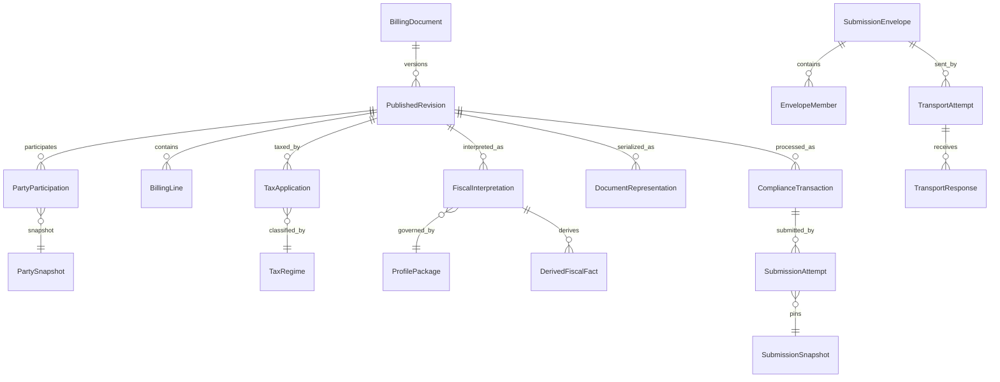

> Approval note: the 18 additional Draft 4.2 field contracts remain Proposed and are not promoted by this approval. Physical persistence and jurisdiction-specific requirements are deferred.

# CTC-003 — Final Detailed Logical Dictionary: Closure Candidate v1.0

**Status: ACCEPTED — scoped detailed logical dictionary, explicitly approved 2026-10-20.**

## Authority, scope and evidence

- Accepted foundation: D2 logical contract, P1–P7, I-01–I-10, T01–T03, D01–D03, L01–L10, batch separation, accepted B/C09 qualified rules and G2 logical ownership.
- Candidate field source: corrected D2 Draft 2.2 as reproduced in Draft 3.8. Typed extension source: G4 Draft 4.2.
- Reference evidence: SemanticDocument v1.0, BillingDocument v0.3, prior CTC-003 focused synthetic tests. No live GitHub checkout or real regulatory conformance claimed.
- Physical FiscalContext A/B/C, database implementation, country mandates, exhaustive G4 migration and full-format tests are out of scope.

## Final working conventions (accepted within scoped dictionary; not separate physical ADR approvals)

1. A required `!` denotes a candidate universal required field on an existing logical record; `?` denotes optional. Document-family/profile minimums remain conditional.
2. Entity names designate logical semantic concepts, not tables or aggregate roots. Typed value objects do not automatically become entities.
3. A path alias may aid compatibility but must not own an independent authoritative value.
4. A submitted attempt pins exact revision, interpretation (if applicable), representation and profile references; no mutable latest reference.
5. A fiscal identifier must be typed by scheme, issuer, jurisdiction, subject and value; a submission/certification reference is not implicitly a fiscal identity.
6. `FiscalEvidence.signatureRef` is the preferred logical reference to a signature artifact. `signatureValueRef` is a source-mapping alias only when verified equivalent; raw signature bytes remain in immutable representations/evidence.
7. Unknown authority reference types remain `TypedExternalReference(kind=UNRESOLVED)` with original bytes/locator; they cannot silently be assigned to `FiscalIdentity`.

## Entity dictionary (accepted at scoped logical level)

### Document and commercial

#### BillingDocument

**Responsibility:** Stable platform document identity; no mutable legal facts.  **Relationship/cardinality:** 0..N PublishedRevision.

| Declared field | Logical type | Required? |
|---|---|---|
| `documentId` | Identifier | Yes |
| `tenantRef` | Identifier | Yes |

**Original candidate declaration:** `documentId: Identifier!; tenantRef: Identifier!`

#### PublishedRevision

**Responsibility:** Published commercial assertions immutable; legal issuance separate.  **Relationship/cardinality:** 1 BillingDocument; 0..N lines/parties/taxes.

| Declared field | Logical type | Required? |
|---|---|---|
| `revisionId` | Identifier | Yes |
| `documentRef` | Identifier | Yes |
| `documentType` | Code | Yes |
| `documentNumber` | Text | Conditional/optional (0..1) |
| `documentSeries` | Text | Conditional/optional (0..1) |
| `legalIdentityNamespace` | Code | Conditional/optional (0..1) |
| `issueDate` | LocalDate | Conditional/optional (0..1) |
| `currency` | CurrencyCode | Conditional/optional (0..1) |
| `contentDigest` | Digest | Yes |
| `publicationProfileRef` | Identifier | Conditional/optional (0..1) |

**Original candidate declaration:** `revisionId: Identifier!; documentRef: Identifier!; documentType: Code!; documentNumber: Text?; documentSeries: Text?; legalIdentityNamespace: Code?; issueDate: LocalDate?; currency: CurrencyCode?; contentDigest: Digest!; publicationProfileRef: Identifier?`

#### PartySnapshot

**Responsibility:** Frozen party facts as represented on document.  **Relationship/cardinality:** 0..N PartyParticipation.

| Declared field | Logical type | Required? |
|---|---|---|
| `partySnapshotId` | Identifier | Yes |
| `legalName` | Text | Conditional/optional (0..1) |
| `taxIdentifiers` | Identifier[] | Conditional/optional (0..N) |
| `address` | Address | Conditional/optional (0..1) |

**Original candidate declaration:** `partySnapshotId: Identifier!; legalName: Text?; taxIdentifiers: Identifier[]; address: Address?`

#### PartyParticipation

**Responsibility:** One frozen party reference; line-level role supported.  **Relationship/cardinality:** 1 revision; 1 snapshot.

| Declared field | Logical type | Required? |
|---|---|---|
| `participationId` | Identifier | Yes |
| `revisionRef` | Identifier | Yes |
| `partySnapshotRef` | Identifier | Yes |
| `role` | Code | Yes |
| `scopeRef` | Identifier | Conditional/optional (0..1) |

**Original candidate declaration:** `participationId: Identifier!; revisionRef: Identifier!; partySnapshotRef: Identifier!; role: Code!; scopeRef: Identifier?`

#### BillingLine

**Responsibility:** Hierarchical signed lines; noncontributing details excluded from totals.  **Relationship/cardinality:** 1 revision; 0..N child lines.

| Declared field | Logical type | Required? |
|---|---|---|
| `lineId` | Identifier | Yes |
| `revisionRef` | Identifier | Yes |
| `parentLineRef` | Identifier | Conditional/optional (0..1) |
| `lineRole` | Code | Yes |
| `contributesToTotals` | Boolean | Yes |
| `netAmount` | Money | Conditional/optional (0..1) |

**Original candidate declaration:** `lineId: Identifier!; revisionRef: Identifier!; parentLineRef: Identifier?; lineRole: Code!; contributesToTotals: Boolean!; netAmount: Money?`

#### Item

**Responsibility:** Product/service description and schemes.  **Relationship/cardinality:** 0..N lines.

| Declared field | Logical type | Required? |
|---|---|---|
| `itemId` | Identifier | Conditional/optional (0..1) |
| `description` | MultilingualText | Conditional/optional (0..1) |
| `classifications` | CodedValue[] | Conditional/optional (0..N) |

**Original candidate declaration:** `itemId: Identifier?; description: MultilingualText?; classifications: CodedValue[]`

#### Price

**Responsibility:** Price basis and inclusion require explicit meaning.  **Relationship/cardinality:** 0..N lines.

| Declared field | Logical type | Required? |
|---|---|---|
| `priceAmount` | Money | Yes |
| `basisQuantity` | Quantity | Conditional/optional (0..1) |
| `inclusion` | Code | Conditional/optional (0..1) |

**Original candidate declaration:** `priceAmount: Money!; basisQuantity: Quantity?; inclusion: Code?`

#### Adjustment

**Responsibility:** Allowance/charge semantics; no double application.  **Relationship/cardinality:** 1 scope.

| Declared field | Logical type | Required? |
|---|---|---|
| `adjustmentId` | Identifier | Yes |
| `scopeRef` | Identifier | Yes |
| `kind` | Code | Yes |
| `amount` | Money | Yes |

**Original candidate declaration:** `adjustmentId: Identifier!; scopeRef: Identifier!; kind: Code!; amount: Money!`

#### DocumentRelationship

**Responsibility:** Credit/correction/replacement distinct from revision.  **Relationship/cardinality:** 2 documents.

| Declared field | Logical type | Required? |
|---|---|---|
| `relationshipId` | Identifier | Yes |
| `sourceDocumentRef` | Identifier | Yes |
| `targetDocumentRef` | Identifier | Yes |
| `relationType` | Code | Yes |

**Original candidate declaration:** `relationshipId: Identifier!; sourceDocumentRef: Identifier!; targetDocumentRef: Identifier!; relationType: Code!`

#### DocumentReference

**Responsibility:** PO/contract/despatch references.  **Relationship/cardinality:** 1 revision.

| Declared field | Logical type | Required? |
|---|---|---|
| `referenceId` | Identifier | Yes |
| `revisionRef` | Identifier | Yes |
| `externalId` | Text | Yes |
| `scheme` | Code | Conditional/optional (0..1) |

**Original candidate declaration:** `referenceId: Identifier!; revisionRef: Identifier!; externalId: Text!; scheme: Code?`

#### Supply

**Responsibility:** Source supply facts separate from derived place-of-supply conclusions.  **Relationship/cardinality:** 1 revision.

| Declared field | Logical type | Required? |
|---|---|---|
| `supplyId` | Identifier | Yes |
| `revisionRef` | Identifier | Yes |
| `location` | Address | Conditional/optional (0..1) |
| `supplyPeriod` | Period | Conditional/optional (0..1) |

**Original candidate declaration:** `supplyId: Identifier!; revisionRef: Identifier!; location: Address?; supplyPeriod: Period?`

#### TaxPoint

**Responsibility:** One reusable tax-point concept.  **Relationship/cardinality:** 1 scope.

| Declared field | Logical type | Required? |
|---|---|---|
| `taxPointId` | Identifier | Yes |
| `scopeRef` | Identifier | Yes |
| `date` | LocalDate | Conditional/optional (0..1) |
| `classificationRef` | Identifier | Conditional/optional (0..1) |

**Original candidate declaration:** `taxPointId: Identifier!; scopeRef: Identifier!; date: LocalDate?; classificationRef: Identifier?`

#### PaymentTerms

**Responsibility:** Payment terms not payment processing.  **Relationship/cardinality:** 1 revision.

| Declared field | Logical type | Required? |
|---|---|---|
| `termsId` | Identifier | Yes |
| `revisionRef` | Identifier | Yes |
| `dueDate` | LocalDate | Conditional/optional (0..1) |
| `terms` | Text | Conditional/optional (0..1) |

**Original candidate declaration:** `termsId: Identifier!; revisionRef: Identifier!; dueDate: LocalDate?; terms: Text?`

#### AttachmentReference

**Responsibility:** Exact referenced attachment artifact.  **Relationship/cardinality:** 0..1 revision; 1 representation.

| Declared field | Logical type | Required? |
|---|---|---|
| `attachmentId` | Identifier | Yes |
| `revisionRef` | Identifier | Conditional/optional (0..1) |
| `representationRef` | Identifier | Yes |
| `purpose` | Code | Conditional/optional (0..1) |

**Original candidate declaration:** `attachmentId: Identifier!; revisionRef: Identifier?; representationRef: Identifier!; purpose: Code?`

### Tax and monetary

#### TaxRegime

**Responsibility:** Scheme identity, not an assessed tax amount.  **Relationship/cardinality:** 0..N TaxApplication.

| Declared field | Logical type | Required? |
|---|---|---|
| `regimeId` | Identifier | Yes |
| `jurisdiction` | Code | Yes |
| `taxScheme` | CodedValue | Yes |

**Original candidate declaration:** `regimeId: Identifier!; jurisdiction: Code!; taxScheme: CodedValue!` (shared scheme definition; applicability registered per revision by `RevisionTaxRegime`)

#### RevisionTaxRegime

**Responsibility:** Revision-scoped regime registration, distinct from shared scheme definition.  **Relationship/cardinality:** 1 revision; 1 scheme.

| Declared field | Logical type | Required? |
|---|---|---|
| `registrationId` | Identifier | Yes |
| `revisionRef` | Identifier | Yes |
| `regimeRef` | Identifier | Yes |
| `applicability` | Code | Yes |

**Original candidate declaration:** `registrationId: Identifier!; revisionRef: Identifier!; regimeRef: Identifier!; applicability: Code!`

#### TaxApplication

**Responsibility:** T01; no summary-as-extra-application.  **Relationship/cardinality:** 1 revision; 1 regime; 1 economic scope.

| Declared field | Logical type | Required? |
|---|---|---|
| `applicationId` | Identifier | Yes |
| `revisionRef` | Identifier | Yes |
| `regimeRef` | Identifier | Yes |
| `scopeType` | Code | Yes |
| `scopeRef` | Identifier | Yes |
| `magnitude` | Money | Yes |
| `direction` | Code | Yes |
| `calculationMethod` | Code | Conditional/optional (0..1) |

**Original candidate declaration:** `applicationId: Identifier!; revisionRef: Identifier!; regimeRef: Identifier!; scopeType: Code! ; scopeRef: Identifier!; magnitude: Money!; direction: Code!; calculationMethod: Code?` (scope and regime must resolve within the same tenant/revision)

#### TaxSummary

**Responsibility:** T02 derived grouping; never overrides source assertions.  **Relationship/cardinality:** 0..N applications.

| Declared field | Logical type | Required? |
|---|---|---|
| `summaryId` | Identifier | Yes |
| `revisionRef` | Identifier | Yes |
| `groupingKeys` | CodedValue[] | Conditional/optional (0..N) |
| `computedAmount` | Money | Conditional/optional (0..1) |

**Original candidate declaration:** `summaryId: Identifier!; revisionRef: Identifier!; groupingKeys: CodedValue[]; computedAmount: Money?`

#### SourceAssertion

**Responsibility:** Preserves source-stated totals/amounts.  **Relationship/cardinality:** 1 representation.

| Declared field | Logical type | Required? |
|---|---|---|
| `assertionId` | Identifier | Yes |
| `representationRef` | Identifier | Yes |
| `concept` | Code | Yes |
| `assertedValue` | TypedValue | Yes |

**Original candidate declaration:** `assertionId: Identifier!; representationRef: Identifier!; concept: Code!; assertedValue: TypedValue!`

#### MonetaryTotal

**Responsibility:** Currency and base explicit.  **Relationship/cardinality:** 1 revision.

| Declared field | Logical type | Required? |
|---|---|---|
| `revisionRef` | Identifier | Yes |
| `documentCurrency` | CurrencyCode | Yes |
| `assertedValues` | Identifier[] | Conditional/optional (0..N) |
| `componentRefs` | Identifier[] | Conditional/optional (0..N) |
| `reconciliationBasisRefs` | Identifier[] | Conditional/optional (0..N) |
| `roundingPolicyRef` | Identifier | Conditional/optional (0..1) |

**Original candidate declaration:** `revisionRef: Identifier!; documentCurrency: CurrencyCode!; assertedValues: Identifier[]; componentRefs: Identifier[]; reconciliationBasisRefs: Identifier[]; roundingPolicyRef: Identifier?`

#### MonetaryBasis

**Responsibility:** Candidate T03 basis; not approved entity shape.  **Relationship/cardinality:** 1 revision.

| Declared field | Logical type | Required? |
|---|---|---|
| `basisId` | Identifier | Yes |
| `revisionRef` | Identifier | Yes |
| `amount` | Money | Yes |
| `taxInclusion` | Code | Yes |

**Original candidate declaration:** `basisId: Identifier!; revisionRef: Identifier!; amount: Money!; taxInclusion: Code!`

#### MonetaryEffect

**Responsibility:** Candidate signed effect relative to explicit basis.  **Relationship/cardinality:** 1 basis.

| Declared field | Logical type | Required? |
|---|---|---|
| `effectId` | Identifier | Yes |
| `basisRef` | Identifier | Yes |
| `applicationRef` | Identifier | Conditional/optional (0..1) |
| `signedContribution` | Money | Yes |

**Original candidate declaration:** `effectId: Identifier!; basisRef: Identifier!; applicationRef: Identifier?; signedContribution: Money!`

#### MonetaryConversion

**Responsibility:** No implicit cross-currency addition.  **Relationship/cardinality:** 0..N monetary facts.

| Declared field | Logical type | Required? |
|---|---|---|
| `conversionId` | Identifier | Yes |
| `sourceMoney` | Money | Yes |
| `targetMoney` | Money | Yes |
| `rate` | Decimal | Yes |
| `effectiveDate` | LocalDate | Conditional/optional (0..1) |
| `provenanceRef` | Identifier | Yes |

**Original candidate declaration:** `conversionId: Identifier!; sourceMoney: Money!; targetMoney: Money!; rate: Decimal!; effectiveDate: LocalDate?; provenanceRef: Identifier!`

#### MonetaryComponent

**Responsibility:** Typed monetary amount; derived and asserted ownership preserved.  **Relationship/cardinality:** 1 revision; 0..1 basis.

| Declared field | Logical type | Required? |
|---|---|---|
| `componentId` | Identifier | Yes |
| `revisionRef` | Identifier | Yes |
| `concept` | Code | Yes |
| `amount` | Money | Yes |
| `basisRef` | Identifier | Conditional/optional (0..1) |
| `sourceAssertionRef` | Identifier | Conditional/optional (0..1) |
| `derivationRef` | Identifier | Conditional/optional (0..1) |
| `currencyConversionRef` | Identifier | Conditional/optional (0..1) |

**Original candidate declaration:** `componentId: Identifier!; revisionRef: Identifier!; concept: Code!; amount: Money!; basisRef: Identifier?; sourceAssertionRef: Identifier?; derivationRef: Identifier?; currencyConversionRef: Identifier?`

#### MonetaryReconciliation

**Responsibility:** G2 proposal; ReconciliationResult compatibility alias only.  **Relationship/cardinality:** 1 revision.

| Declared field | Logical type | Required? |
|---|---|---|
| `evaluationId` | Identifier | Yes |
| `revisionRef` | Identifier | Yes |
| `basisRef` | Identifier | Conditional/optional (0..1) |
| `sourceAssertionRefs` | Identifier[] | Conditional/optional (0..N) |
| `componentRefs` | Identifier[] | Conditional/optional (0..N) |
| `roundingPolicyRef` | Identifier | Conditional/optional (0..1) |
| `computedAmount` | Money | Conditional/optional (0..1) |
| `outcome` | Code | Yes |

**Original candidate declaration:** `evaluationId: Identifier!; revisionRef: Identifier!; basisRef: Identifier?; sourceAssertionRefs: Identifier[]; componentRefs: Identifier[]; roundingPolicyRef: Identifier?; computedAmount: Money?; outcome: Code!` (NOT_EVALUABLE if required conversion or basis missing)

### Fiscal and provenance

#### SourceFiscalFact

**Responsibility:** Original local fiscal code, not duplicate core fact.  **Relationship/cardinality:** 1 revision; 1 representation.

| Declared field | Logical type | Required? |
|---|---|---|
| `factId` | Identifier | Yes |
| `revisionRef` | Identifier | Yes |
| `sourceRepresentationRef` | Identifier | Yes |
| `semanticConcept` | Code | Yes |
| `value` | TypedValue | Yes |
| `sourceLocatorRef` | Identifier | Yes |

**Original candidate declaration:** `factId: Identifier!; revisionRef: Identifier!; sourceRepresentationRef: Identifier!; semanticConcept: Code!; value: TypedValue!; sourceLocatorRef: Identifier!`

#### FiscalInterpretation

**Responsibility:** Pinned reproducible interpretation; physical placement deferred.  **Relationship/cardinality:** 1 revision; 1 package; 0..N derived facts.

| Declared field | Logical type | Required? |
|---|---|---|
| `interpretationId` | Identifier | Yes |
| `revisionRef` | Identifier | Yes |
| `profilePackageRef` | Identifier | Yes |
| `inputManifestRef` | Identifier | Yes |
| `inputManifestDigest` | Digest | Yes |
| `interpretationDigest` | Digest | Yes |

**Original candidate declaration:** `interpretationId: Identifier!; revisionRef: Identifier!; profilePackageRef: Identifier!; inputManifestRef: Identifier!; inputManifestDigest: Digest!; interpretationDigest: Digest!` (manifest resolvable, digest/canonicalization verified)

#### InterpretationInputManifest

**Responsibility:** Complete, resolvable interpretation input closure.  **Relationship/cardinality:** 1 revision; immutable members.

| Declared field | Logical type | Required? |
|---|---|---|
| `manifestId` | Identifier | Yes |
| `revisionRef` | Identifier | Yes |
| `sourceFactRefs` | Identifier[] | Conditional/optional (0..N) |
| `billingFactRefs` | Identifier[] | Conditional/optional (0..N) |
| `enrichmentRefs` | Identifier[] | Conditional/optional (0..N) |
| `rulePackageRefs` | Identifier[] | Conditional/optional (0..N) |
| `mappingPackageRefs` | Identifier[] | Conditional/optional (0..N) |
| `codeListPackageRefs` | Identifier[] | Conditional/optional (0..N) |
| `canonicalizationScheme` | Code | Yes |
| `contentDigest` | Digest | Yes |

**Original candidate declaration:** `manifestId: Identifier!; revisionRef: Identifier!; sourceFactRefs: Identifier[]; billingFactRefs: Identifier[]; enrichmentRefs: Identifier[]; rulePackageRefs: Identifier[]; mappingPackageRefs: Identifier[]; codeListPackageRefs: Identifier[]; canonicalizationScheme: Code!; contentDigest: Digest!`

#### DerivedFiscalFact

**Responsibility:** Never overwrites source facts.  **Relationship/cardinality:** 1 interpretation; 1 provenance.

| Declared field | Logical type | Required? |
|---|---|---|
| `factId` | Identifier | Yes |
| `interpretationRef` | Identifier | Yes |
| `concept` | Code | Yes |
| `value` | TypedValue | Yes |
| `provenanceRef` | Identifier | Yes |

**Original candidate declaration:** `factId: Identifier!; interpretationRef: Identifier!; concept: Code!; value: TypedValue!; provenanceRef: Identifier!`

#### SourceLocator

**Responsibility:** Exact source location in immutable artifact.  **Relationship/cardinality:** 1 representation.

| Declared field | Logical type | Required? |
|---|---|---|
| `locatorId` | Identifier | Yes |
| `representationRef` | Identifier | Yes |
| `locatorExpression` | Text | Yes |

**Original candidate declaration:** `locatorId: Identifier!; representationRef: Identifier!; locatorExpression: Text!`

#### FactProvenance

**Responsibility:** Closed input manifest; zero source facts allowed only for explicit external derivation.  **Relationship/cardinality:** 1 revision.

| Declared field | Logical type | Required? |
|---|---|---|
| `provenanceId` | Identifier | Yes |
| `sourceFactRefs` | Identifier[] | Conditional/optional (0..N) |
| `sourceRevisionRef` | Identifier | Yes |
| `rulePackageRef` | Identifier | Conditional/optional (0..1) |
| `enrichmentRefs` | Identifier[] | Conditional/optional (0..N) |

**Original candidate declaration:** `provenanceId: Identifier!; sourceFactRefs: Identifier[]; sourceRevisionRef: Identifier!; rulePackageRef: Identifier?; enrichmentRefs: Identifier[]`

#### EnrichmentSnapshot

**Responsibility:** Pinned external inputs.  **Relationship/cardinality:** 0..N provenance.

| Declared field | Logical type | Required? |
|---|---|---|
| `enrichmentId` | Identifier | Yes |
| `providerRef` | Identifier | Yes |
| `capturedAt` | Instant | Yes |
| `payloadDigest` | Digest | Yes |

**Original candidate declaration:** `enrichmentId: Identifier!; providerRef: Identifier!; capturedAt: Instant!; payloadDigest: Digest!`

#### ProfilePackage

**Responsibility:** Immutable versioned package.  **Relationship/cardinality:** 0..N interpretations.

| Declared field | Logical type | Required? |
|---|---|---|
| `profilePackageId` | Identifier | Yes |
| `jurisdiction` | Code | Yes |
| `version` | Text | Yes |
| `contentDigest` | Digest | Yes |
| `rulesDigest` | Digest | Yes |
| `codeListDigests` | Digest[] | Conditional/optional (0..N) |

**Original candidate declaration:** `profilePackageId: Identifier!; jurisdiction: Code!; version: Text!; contentDigest: Digest!; rulesDigest: Digest!; codeListDigests: Digest[]`

### Representation, compliance and transport

#### DocumentRepresentation

**Responsibility:** Exact original/generated/submitted/certified bytes.  **Relationship/cardinality:** 0..1 revision; 0..1 ingestion.

| Declared field | Logical type | Required? |
|---|---|---|
| `representationId` | Identifier | Yes |
| `kind` | Code | Yes |
| `format` | Code | Yes |
| `contentDigest` | Digest | Yes |
| `revisionRef` | Identifier | Conditional/optional (0..1) |
| `ingestionRef` | Identifier | Conditional/optional (0..1) |

**Original candidate declaration:** `representationId: Identifier!; kind: Code!; format: Code!; contentDigest: Digest!; revisionRef: Identifier?; ingestionRef: Identifier?`

#### ComplianceTransaction

**Responsibility:** Distinct per-document operation.  **Relationship/cardinality:** 1 revision; 0..N attempts/events.

| Declared field | Logical type | Required? |
|---|---|---|
| `transactionId` | Identifier | Yes |
| `revisionRef` | Identifier | Yes |
| `obligationRef` | Identifier | Yes |
| `destinationRef` | Identifier | Yes |

**Original candidate declaration:** `transactionId: Identifier!; revisionRef: Identifier!; obligationRef: Identifier!; destinationRef: Identifier!`

#### SubmissionSnapshot

**Responsibility:** Immutable pinned submission basis.  **Relationship/cardinality:** 1 revision; 1 outbound representation.

| Declared field | Logical type | Required? |
|---|---|---|
| `snapshotId` | Identifier | Yes |
| `revisionRef` | Identifier | Yes |
| `revisionDigest` | Digest | Yes |
| `interpretationRef` | Identifier | Conditional/optional (0..1) |
| `representationRef` | Identifier | Yes |
| `representationDigest` | Digest | Yes |
| `profilePackageRef` | Identifier | Conditional/optional (0..1) |
| `mappingPackageRef` | Identifier | Conditional/optional (0..1) |
| `packageApplicability` | Code | Yes |

**Original candidate declaration:** `snapshotId: Identifier!; revisionRef: Identifier!; revisionDigest: Digest!; interpretationRef: Identifier?; representationRef: Identifier!; representationDigest: Digest!; profilePackageRef: Identifier?; mappingPackageRef: Identifier?; packageApplicability: Code!`

#### SubmissionAttempt

**Responsibility:** Per-document attempt distinct from transport attempt.  **Relationship/cardinality:** 1 transaction; 1 snapshot.

| Declared field | Logical type | Required? |
|---|---|---|
| `submissionAttemptId` | Identifier | Yes |
| `transactionRef` | Identifier | Yes |
| `snapshotRef` | Identifier | Yes |
| `transportAttemptRef` | Identifier | Conditional/optional (0..1) |

**Original candidate declaration:** `submissionAttemptId: Identifier!; transactionRef: Identifier!; snapshotRef: Identifier!; transportAttemptRef: Identifier?`

#### ProcessingEvent

**Responsibility:** Append-only; legal status not inferred from transport receipt.  **Relationship/cardinality:** 1 typed subject.

| Declared field | Logical type | Required? |
|---|---|---|
| `eventId` | Identifier | Yes |
| `subjectType` | Code | Yes |
| `subjectRef` | Identifier | Yes |
| `eventType` | Code | Yes |
| `observedAt` | Instant | Yes |
| `evidenceRefs` | Identifier[] | Conditional/optional (0..N) |

**Original candidate declaration:** `eventId: Identifier!; subjectType: Code!; subjectRef: Identifier!; eventType: Code!; observedAt: Instant!; evidenceRefs: Identifier[]`

#### ValidationFinding

**Responsibility:** Non-destructive validation.  **Relationship/cardinality:** 1 subject.

| Declared field | Logical type | Required? |
|---|---|---|
| `findingId` | Identifier | Yes |
| `subjectRef` | Identifier | Yes |
| `ruleRef` | Identifier | Yes |
| `severity` | Code | Yes |
| `message` | Text | Yes |

**Original candidate declaration:** `findingId: Identifier!; subjectRef: Identifier!; ruleRef: Identifier!; severity: Code!; message: Text!`

#### ResponseCorrelation

**Responsibility:** Ambiguous correlation remains unknown.  **Relationship/cardinality:** 0..1 resolved subject.

| Declared field | Logical type | Required? |
|---|---|---|
| `correlationId` | Identifier | Yes |
| `responseRef` | Identifier | Yes |
| `candidateSubjectRefs` | Identifier[] | Conditional/optional (0..N) |
| `resolutionState` | Code | Yes |
| `resolvedSubjectRef` | Identifier | Conditional/optional (0..1) |
| `resolutionEvidenceRefs` | Identifier[] | Conditional/optional (0..N) |
| `reason` | Text | Conditional/optional (0..1) |

**Original candidate declaration:** `correlationId: Identifier!; responseRef: Identifier!; candidateSubjectRefs: Identifier[]; resolutionState: Code!; resolvedSubjectRef: Identifier?; resolutionEvidenceRefs: Identifier[]; reason: Text?` (RESOLVED requires one unique candidate and evidence; AMBIGUOUS forbids resolvedSubjectRef)

#### FiscalIdentity

**Responsibility:** Typed authority identity, not transport correlation.  **Relationship/cardinality:** 1 artifact.

| Declared field | Logical type | Required? |
|---|---|---|
| `fiscalIdentityId` | Identifier | Yes |
| `issuerRef` | Identifier | Yes |
| `scheme` | Code | Yes |
| `value` | Text | Yes |
| `artifactRef` | Identifier | Yes |

**Original candidate declaration:** `fiscalIdentityId: Identifier!; issuerRef: Identifier!; scheme: Code!; value: Text!; artifactRef: Identifier!`

#### FiscalEvidence

**Responsibility:** Receipt/signature/clearance evidence preserved.  **Relationship/cardinality:** 1 artifact.

| Declared field | Logical type | Required? |
|---|---|---|
| `evidenceId` | Identifier | Yes |
| `artifactRef` | Identifier | Yes |
| `evidenceType` | Code | Yes |
| `representationRef` | Identifier | Conditional/optional (0..1) |

**Original candidate declaration:** `evidenceId: Identifier!; artifactRef: Identifier!; evidenceType: Code!; representationRef: Identifier?`

#### IngestionRecord

**Responsibility:** Completed external ingestion retains >=1 original artifact.  **Relationship/cardinality:** 0..N extractions.

| Declared field | Logical type | Required? |
|---|---|---|
| `ingestionId` | Identifier | Yes |
| `sourceArtifactRefs` | Identifier[] | Conditional/optional (0..N) |
| `receivedAt` | Instant | Yes |
| `tenantRef` | Identifier | Yes |

**Original candidate declaration:** `ingestionId: Identifier!; sourceArtifactRefs: Identifier[]; receivedAt: Instant!; tenantRef: Identifier!`

#### DocumentExtraction

**Responsibility:** Batch extraction not automatically legal identity.  **Relationship/cardinality:** 1 ingestion; 0..1 document.

| Declared field | Logical type | Required? |
|---|---|---|
| `extractionId` | Identifier | Yes |
| `ingestionRef` | Identifier | Yes |
| `sourceMemberLocator` | Text | Yes |
| `documentRef` | Identifier | Conditional/optional (0..1) |

**Original candidate declaration:** `extractionId: Identifier!; ingestionRef: Identifier!; sourceMemberLocator: Text!; documentRef: Identifier?`

#### WorkingDocument

**Responsibility:** Pre-publication mutable working state.  **Relationship/cardinality:** 0..1 extraction; 0..1 document.

| Declared field | Logical type | Required? |
|---|---|---|
| `workingId` | Identifier | Yes |
| `extractionRef` | Identifier | Conditional/optional (0..1) |
| `documentRef` | Identifier | Conditional/optional (0..1) |
| `state` | Code | Yes |

**Original candidate declaration:** `workingId: Identifier!; extractionRef: Identifier?; documentRef: Identifier?; state: Code!`

#### SubmissionEnvelope

**Responsibility:** Transport container not billing identity.  **Relationship/cardinality:** 0..N members in draft; >=1 submitted.

| Declared field | Logical type | Required? |
|---|---|---|
| `envelopeId` | Identifier | Yes |
| `destinationRef` | Identifier | Yes |
| `payloadRepresentationRef` | Identifier | Conditional/optional (0..1) |
| `memberManifestDigest` | Digest | Conditional/optional (0..1) |

**Original candidate declaration:** `envelopeId: Identifier!; destinationRef: Identifier!; payloadRepresentationRef: Identifier?; memberManifestDigest: Digest?`

#### EnvelopeMember

**Responsibility:** Member-specific processing and correlation.  **Relationship/cardinality:** 1 envelope; 1 transaction.

| Declared field | Logical type | Required? |
|---|---|---|
| `memberId` | Identifier | Yes |
| `envelopeRef` | Identifier | Yes |
| `transactionRef` | Identifier | Yes |
| `snapshotRef` | Identifier | Yes |
| `revisionRef` | Identifier | Yes |
| `memberRepresentationRef` | Identifier | Yes |
| `payloadMemberLocator` | Text | Conditional/optional (0..1) |

**Original candidate declaration:** `memberId: Identifier!; envelopeRef: Identifier!; transactionRef: Identifier!; snapshotRef: Identifier!; revisionRef: Identifier!; memberRepresentationRef: Identifier!; payloadMemberLocator: Text?` (member representation must match snapshot; envelope payload is separately pinned by TransportAttempt)

#### TransportAttempt

**Responsibility:** Transport retry creates new attempt.  **Relationship/cardinality:** 1 envelope; 1 immutable payload.

| Declared field | Logical type | Required? |
|---|---|---|
| `transportAttemptId` | Identifier | Yes |
| `envelopeRef` | Identifier | Yes |
| `payloadRepresentationRef` | Identifier | Yes |
| `submittedAt` | Instant | Conditional/optional (0..1) |

**Original candidate declaration:** `transportAttemptId: Identifier!; envelopeRef: Identifier!; payloadRepresentationRef: Identifier!; submittedAt: Instant?`

#### TransportResponse

**Responsibility:** Envelope response != member acceptance.  **Relationship/cardinality:** 1 attempt; optional member.

| Declared field | Logical type | Required? |
|---|---|---|
| `responseId` | Identifier | Yes |
| `attemptRef` | Identifier | Yes |
| `representationRef` | Identifier | Yes |
| `subjectType` | Code | Yes |
| `memberRef` | Identifier | Conditional/optional (0..1) |

**Original candidate declaration:** `responseId: Identifier!; attemptRef: Identifier!; representationRef: Identifier!; subjectType: Code!; memberRef: Identifier?`

#### LegalStateAssessment

**Responsibility:** Legal state based on profile/evidence.  **Relationship/cardinality:** 1 revision.

| Declared field | Logical type | Required? |
|---|---|---|
| `assessmentId` | Identifier | Yes |
| `revisionRef` | Identifier | Yes |
| `profilePackageRef` | Identifier | Yes |
| `evidenceRefs` | Identifier[] | Conditional/optional (0..N) |
| `result` | Code | Yes |

**Original candidate declaration:** `assessmentId: Identifier!; revisionRef: Identifier!; profilePackageRef: Identifier!; evidenceRefs: Identifier[]; result: Code!`

#### DuplicateResolution

**Responsibility:** Repeated reception != duplicate legal document.  **Relationship/cardinality:** 0..N ingestions.

| Declared field | Logical type | Required? |
|---|---|---|
| `resolutionId` | Identifier | Yes |
| `ingestionRefs` | Identifier[] | Conditional/optional (0..N) |
| `candidateDocumentRefs` | Identifier[] | Conditional/optional (0..N) |
| `basis` | Code | Yes |
| `result` | Code | Yes |

**Original candidate declaration:** `resolutionId: Identifier!; ingestionRefs: Identifier[]; candidateDocumentRefs: Identifier[]; basis: Code!; result: Code!`

## Targeted ambiguity resolutions for closure

| Issue | Closure-candidate disposition | Approval boundary |
|---|---|---|
| FiscalIdentity.value | Preserve typed value within identity record; scheme, issuer, jurisdiction and subject context must resolve. | Logical field contract only |
| Generic authorityRef | Use typed external reference; map to FiscalIdentity only with proven identity semantics. | No automatic fiscal identity promotion |
| signatureRef / signatureValueRef | One authoritative evidence-artifact reference (`signatureRef`); `signatureValueRef` is conditional source alias. | Does not delete source-native signature data |
| Payment terms vs instructions | Separate terms from payment method/account instruction value object. | Detailed field paths proposed |
| Profile scope | Explicit mandate/jurisdiction/effective-date context on profile package. | No asserted country legal rules |

## Deferred Draft 4.2 field proposals (not automatically approved)

| Path | Logical type | Cardinality | Disposition |
|---|---|---|---|
| `FiscalEvidence.signatureValueRef` | ArtifactReference | 0..1 | Candidate extension; alias review |
| `FiscalEvidence.signatureAlgorithm` | CodedValue | 0..1 | Candidate extension; profile/lifecycle condition |
| `FiscalEvidence.certificateIdentifier` | String | 0..1 | Candidate extension; profile/lifecycle condition |
| `FiscalEvidence.signedAt` | Instant | 0..1 | Candidate extension; profile/lifecycle condition |
| `FiscalEvidence.chainPreviousHash` | Digest | 0..1 | Candidate extension; profile/lifecycle condition |
| `DocumentRepresentation.formatFamily` | CodedValue | 0..1 | Candidate extension; profile/lifecycle condition |
| `DocumentRepresentation.formatVersion` | String | 0..1 | Candidate extension; profile/lifecycle condition |
| `ComplianceTransaction.mandateScopeRef` | MandateScopeReference | 0..1 | Candidate extension; profile/lifecycle condition |
| `ProfilePackage.scope` | MandateScope | 1 | Candidate extension; profile/lifecycle condition |
| `ComplianceTransaction.processingModel` | CodedValue | 0..1 | Candidate extension; profile/lifecycle condition |
| `FiscalEvidence.signatureRef` | EvidenceReference | 0..1 | Candidate extension; profile/lifecycle condition |
| `DocumentRepresentation.signatureMetadata` | SignatureMetadata | 0..1 | Candidate extension; profile/lifecycle condition |
| `FiscalEvidence.qrPayload` | BinaryOrTextReference | 0..1 | Candidate extension; profile/lifecycle condition |
| `FiscalEvidence.counterProof` | EvidenceReference | 0..1 | Candidate extension; profile/lifecycle condition |
| `DocumentRepresentation.profileIdentifier` | String | 0..1 | Candidate extension; profile/lifecycle condition |
| `PublishedRevision.paymentTerms` | PaymentTerms | 0..1 | Candidate extension; profile/lifecycle condition |
| `FiscalInterpretation.jurisdiction` | JurisdictionReference | 1 | Candidate extension; profile/lifecycle condition |
| `DocumentRepresentation.sourceArtifactRef` | ArtifactReference | 0..1 | Candidate extension; profile/lifecycle condition |

## Relationships and integrity checks

### Mandatory reference constraints

- Every cross-entity reference resolves to an exact typed identifier within tenant scope; absence or ambiguity is not treated as success.
- PublishedRevision and associated party snapshots are immutable.
- TaxApplication revision/scope/regime references are consistent; summary assertions do not become duplicate tax applications.
- Interpretation input manifests, rule packages and code lists resolve to immutable artifacts.
- Envelope members and submission snapshots agree on document revision and representation.
- Member-level acceptance requires member-specific evidence, not merely envelope transport receipt.
- Cross-currency reconciliation requires a pinned conversion source and rounding context; otherwise NOT_EVALUABLE.

## Completion assessment

The catalogue is consolidated as a **logical closure candidate**. The mechanical audit accompanying this package verifies field-path uniqueness, owner existence, logical type presence and declared relationship targets. This is not a full schema validator or evidence of regulatory compliance.

**Requested decision:** approve CTC-003 at detailed logical entity-dictionary scope only, after reviewing the candidate value-object extensions and listed unresolved issues. Do not infer acceptance from earlier blitz authorizations.

**Transfer to existing backlog:** CTC-004 tax/regulatory testing; CTC-006 party/correction refinements; CTC-007 version compatibility; CTC-009 field-level semantic-loss matrix; CTC-010 real jurisdiction fixtures; CTC-011 physical/logical persistence.

## Session checkpoint

- Findings: consolidation confirms field-path and alias governance as primary closure concerns; no new regulatory finding.
- Proposed decisions: final candidate dictionary and three typed-reference resolutions.
- Approved in this session: none.
- Suggested register updates: mark CTC-003 Review, link this candidate; do not mark Done before explicit approval.
- Next task: CTC-003 scoped closure decision, then CTC-004.
