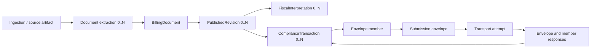

# CTC-003 — Unified Cardinality and Reference Consistency Review, Draft 1.2

**Status:** Candidate model and evidence review; not an approved detailed entity schema.  
**Baseline:** CTC-002 D2/P1–P7/I-01–I-10; CTC-003 T01–T03, D01–D03, L01–L10, BATCH-01, B01–B10 and C09-02/C09-07 accepted at their recorded logical scope.

## Scope and evidence

This document consolidates accepted batch transport separation into the proposed D2 dictionary and reviews remaining C09 cardinalities. Source: prior Drafts 0.5, 0.7, 0.9, 1.0, 1.1 and the latest blitz decision register. The accompanying 22-case synthetic Python suite exercises selected reference constraints. It does not establish real-world tax authority or provider conformance. No schema or new ADR is automatically accepted.

## Logical contract composition

The diagram describes references, not physical ownership or database tables. A transport envelope is not a legal invoice. Envelope outcomes and member outcomes are separately typed.

## Conditional cardinality decision matrix

| ID | Candidate logical rule | Evidence and caveat | Recommendation |
|---|---|---|---|
| C09-01 | Reception/ingestion retains 1..N immutable original artifact references | Supported as an audit principle; a purely internal generated record may have no external reception | Approve only for a completed external reception, with precise event definition |
| C09-02 | One reception has 0..N extractions; extraction resolves to 0..1 logical document | Already accepted, logical | Retain |
| C09-03 | BillingDocument has 0..N published revisions; >=1 after first publication | Tested draft without revision and published revision reference; define publication boundary separately | Ready for logical review |
| C09-04 | Revision has 0..N participations and lines globally; profile defines required minimums | Synthetic tests show sparse global structure can coexist with profile-level rejection | Ready for logical review; do not claim every published invoice may omit seller/lines |
| C09-05 | Every PartyParticipation resolves to exactly one immutable PartySnapshot when published | Synthetic broken-reference/mutable snapshot controls pass | Ready for logical review |
| C09-06 | Revision has 0..N fiscal interpretations; each pins one revision and complete immutable input/profile manifest | Multiple interpretations tested synthetically; actual regulatory need not demonstrated | Ready for logical review, not physical root approval |
| C09-07 | Submitted transport attempt pins one immutable payload with 1..N member refs for multi-member envelope | Already accepted, logical | Retain |
| C09-08 | Revision has 0..N legal assessments; compliance transaction has 0..N processing events | Synthetic unknown/issued/cancelled outcomes and typed-event checks; legal-state rules are jurisdiction-specific | Ready for logical review |

## Instance outcomes and negative controls

1. Draft without published revision: allowed; not deemed legally issued.
2. Published revision with frozen party references: allowed; mutable snapshot rejected.
3. Same revision with two pinned fiscal interpretations: structurally allowed; not evidence of a regulatory requirement.
4. Missing manifest/profile digest: rejected in prototype.
5. Legal state UNDETERMINED without external evidence: allowed; ISSUED/CANCELLED without evidence: rejected by this test policy. Note that some regimes permit issuance without an external authority response; 'evidence' may be the applicable internally recorded legal basis and not necessarily an authority receipt.
6. Profile-specific minimum seller/line requirements: checked independently of globally permissive structure.
7. Typed events and correlation: checked at basic subject-reference level; provider response uniqueness and legal semantics remain separate evidence tasks.

## Findings

- F-003-C12-01: The remaining C09 relationships can be expressed as conditional logical constraints without selecting physical aggregate roots (synthetic support).
- F-003-C12-02: Global structural permissiveness must be paired with profile-specific publication validation (synthetic support; no official jurisdictional profile executed).
- F-003-C12-03: Evidence-based legal-state assessment must not be equated with an authority receipt in every regime (design qualification).
- F-003-C12-04: Multiple fiscal interpretations are structurally supportable but remain unproven as a mandatory regulatory requirement.
- F-003-C12-05: B01–B10 and C09-02/C09-07 can coexist with proposed C09-01/03/04/05/06/08 without requiring a batch to become a BillingDocument.

## Recommended next decision and work

Approve C09-01, C09-03, C09-04, C09-05, C09-06 and C09-08 at logical cardinality level only, **if** the qualification on C09-01 (completed external receptions) and C09-08 (jurisdiction-scoped legal evidence, not necessarily authority receipt) is accepted. This is a recommendation, not a recorded approval. Preserve exact entity shapes, legal profile requirements, provider correlation behavior and FiscalContext physical A/B/C as deferred.

CTC-003 stays In Progress pending unified entity dictionary acceptance, base value types, source-to-model traceability, and representative document examples. Route tax validation to CTC-004, parties/corrections to CTC-006, profiles to CTC-005, and real fixture testing to CTC-008/009/010.
