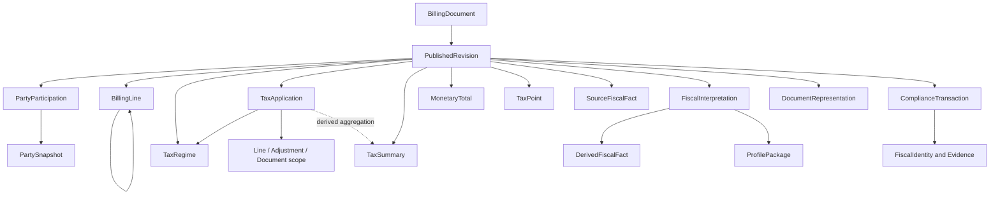

# CTC-003 — Unified Semantic Entity Dictionary

**Version:** Draft 0.4 | **Date:** 2026-10-20 | **Status:** PROPOSED / NOT APPROVED
**Task:** CTC-003 | **Basis:** Approved D2 nine-concept logical contract, P1–P7, I-01–I-10, T01/T02/T03 logical policies.

## 1. Authority and limitations

This draft consolidates the existing commercial Draft 0.2 and tax/monetary Draft 0.3. It does not approve new fields, cardinalities, database tables, aggregate roots, or jurisdiction-specific tax rules. Where the older source models disagree, the approved D2 principles and task-local tax decisions control the logical interpretation, but the detailed shape remains open. Remote GitHub HEAD was not verified. The detailed text of the accepted D2 invariants is in the existing approved contract; this draft does not restate or alter it.

**Source trace:** Commercial Draft 0.2; Tax Draft 0.3; `semantic-billing-model(1) (1).md` v0.3; `CTC-Semantic-Document-Entity-Model.docx` v1.0; CTC-003-T03 decision-ready review and accepted DECISIONS.md. No new jurisdiction fixture validation was performed.

## 2. Unified ownership rules

| Fact / responsibility | Proposed authoritative owner | Important qualification |
|---|---|---|
| Platform document identity | BillingDocument | Not the commercial invoice number |
| As-issued number, type, date, parties, lines, amounts | PublishedRevision | Root-level current values only projections |
| Party details printed on invoice | PartySnapshot referenced by PartyParticipation | Not a live ERP master record |
| Individual scoped tax amount and method | TaxApplication | T01 accepted; concrete fields proposed |
| Tax scheme and jurisdiction | TaxRegime | Distinct from FiscalInterpretation |
| Source tax subtotal | Source assertion in TaxSummary context | Must not be replaced by calculated summary (T02) |
| Derived tax subtotal | TaxSummary calculation | Derived from non-overlapping applications |
| Tax-point source meaning | TaxPoint | One shared concept; local interpretation separately versioned |
| Original local fiscal codes | SourceFiscalFact | Source and scheme preserved (P7) |
| Derived local classification | DerivedFiscalFact under FiscalInterpretation | Profile/rule/code-list versions required |
| Exact XML/JSON representation | DocumentRepresentation | Independently preserved (P3) |
| Authority outcome and attempt | ComplianceTransaction / event concepts | Independent from invoice semantics (P1/P5) |
| Fiscal identity and receipts | FiscalIdentity / FiscalEvidence | Separate from submission identity (P4) |

## 3. Consolidated detailed entity catalogue

`1` = required, `0..1` = optional, `0..N` = collection, `1..N` = nonempty collection. All cardinalities below are **proposed** and may be conditional on published document type/profile.

| ID | Entity / value object | Key attributes (candidate) | Relationship / cardinality (candidate) | Source |
|---|---|---|---|---|
| DOC-01 | BillingDocument | documentId, tenantRef | 0..N PublishedRevision | Commercial 0.2 |
| DOC-02 | PublishedRevision | revisionId, documentRef, number, series?, type, issueDate, documentCurrency | 1 document; 1..N BillingLine for ordinary published invoice | Commercial 0.2 |
| PARTY-01 | PartySnapshot | snapshotId, names, identifiers, registrations, addresses | 1..N PartyParticipation references | Commercial 0.2 |
| PARTY-02 | PartyParticipation | role, scopeRef, partySnapshotRef | 2..N for ordinary published invoice; line roles 0..N | Commercial 0.2 |
| PARTY-03 | Identifier | value, scheme, issuer?, jurisdiction? | 0..N per party | Commercial 0.2 |
| PARTY-04 | TaxRegistration | identifier, scheme, jurisdiction | 0..N per party | Commercial 0.2 |
| PARTY-05 | LegalRegistration | identifier, authority, legalForm? | 0..N per party | Commercial 0.2 |
| PARTY-06 | Address | lines, locality, region?, postalCode?, country | 0..N per party | Commercial 0.2 |
| PARTY-07 | Contact | name?, email?, phone? | 0..N per party | Commercial 0.2 |
| LINE-01 | BillingLine | lineId, role, parentRef?, contributesToTotals, quantity?, netAmount | 0..N children; no cycles | Commercial 0.2 |
| LINE-02 | Item | descriptions, classifications | 0..1 per line | Commercial 0.2 |
| LINE-03 | ItemClassification | codedValue, scheme | 0..N per item | Commercial 0.2 |
| LINE-04 | Quantity | decimalValue, unit | 0..1 per line | Commercial 0.2 |
| LINE-05 | Price | amount, baseQuantity?, inclusion?, adjustmentRefs | 0..1 per line | Commercial 0.2; T03 |
| LINE-06 | Adjustment | scopeRef, type, amount, reason? | 0..N price/line/document | Commercial 0.2 |
| REL-01 | DocumentRelationship | relationshipType, sourceRevisionRef, targetDocumentRef | 0..N per revision | Commercial 0.2 |
| REL-02 | DocumentReference | external/internal identity, issuer?, issueDate? | 1 per relationship | Commercial 0.2 |
| COM-01 | Supply | delivery/location/period facts | 0..1 per revision | Commercial 0.2 |
| COM-02 | Period | start?, end? | 0..N at applicable scope | Commercial 0.2 |
| COM-03 / TAX-04 | **TaxPoint (unified)** | date?, basis?, sourceFactRefs? | 0..N at document/line scope; exact cardinality open | Both drafts |
| COM-04 | Note | type?, text, language? | 0..N per revision/line | Commercial 0.2 |
| COM-05 | PaymentMeans | meansCode, accountRef?, reference? | 0..N per revision | Commercial 0.2 |
| COM-06 | PaymentTerms | dueDate?, terms, installment? | 0..N per revision | Commercial 0.2 |
| COM-07 | FinancialAccount | accountId, bankCode?, owner? | 0..N referenced by payment means | Commercial 0.2 |
| COM-08 | AttachmentReference | artifactRef, type?, description? | 0..N per revision | Commercial 0.2 |
| TAX-01 | TaxRegime | regimeId, scheme, type, jurisdiction? | 0..N per revision | Tax 0.3 / T01 |
| TAX-02 | TaxApplication | applicationId, regimeRef, scopeRef, category?, rate?, magnitude?, direction? | 0..N per revision; 1 regime and 1 scope | Tax 0.3 / T01/T03 |
| TAX-03 | TaxSummary | groupKey, asserted?, calculated?, variance? | 0..N per revision; underlying applications 0..N | Tax 0.3 / T02 |
| MON-01 | MonetaryTotal | lineTotal?, taxExclusive?, taxInclusive?, payable?, currency | 1 for published ordinary invoice (proposed) | Tax 0.3 / T03 |
| MON-02 | MonetaryConversion | fromMoney, toMoney, rate, rateDate, source | 0..N per revision or calculation | Tax 0.3 / T03 |
| MON-03 | ReconciliationResult | basisRef, assertionRef, calculatedValue?, variance?, outcome | 0..N per revision; may be NOT_EVALUABLE | Tax 0.3 / T02/T03 |
| MON-C01 | MonetaryBasis | basis amount, currency, includedComponents, scope | Candidate logical concept; shape unapproved | T03 |
| MON-C02 | MonetaryEffect | basisRef, signedContribution, polarity, derivationRef | Candidate logical concept; shape unapproved | T03 |
| MON-C03 | DocumentEconomicEffect | perspective, polarity, amount? | Candidate only | T03 |
| MON-C04 | MonetaryReconciliation | asserted, computed, tolerance?, result | Candidate only; overlap with MON-03 to resolve | T03 |

## 4. D2 companion concepts (not yet detailed here)

The approved D2 nine-concept contract also requires explicit detailed treatment of `SourceFiscalFact`, `FiscalInterpretation`, `DerivedFiscalFact`, `ProfilePackage`, `DocumentRepresentation`, `ComplianceTransaction`, and `FiscalIdentity/Evidence`. These are **not omitted from the logical model**: they remain approved logical categories whose attributes and cardinalities are **pending CTC-003 dictionary work**. Their physical aggregate structure is deferred.

## 5. Draft relationship diagram

## 6. Reconciliation of overlap and naming

| Conflict | Proposed resolution | Status |
|---|---|---|
| TaxPoint defined in both commercial and tax drafts | One TaxPoint semantic concept, referenced at applicable scope | Proposed |
| `PublishedRevision.taxFacts` vs TaxRegime/TaxApplication | Use scoped TaxApplication for calculations and SourceFiscalFact for source local codes; avoid duplicating authoritative facts | Proposed detailed mapping; T01 approved logically |
| `TaxSummary` vs source subtotal | Preserve source assertion separately from derived aggregate and reconciliation finding | T02 accepted logically; schema proposed |
| `MonetaryTotal` asserted vs calculated | Preserve as-issued assertions and calculate comparison independently | T03 accepted logically; field shape proposed |
| `MonetaryBasis` / `MonetaryEffect` vs `ReconciliationResult` | Keep as candidate logical concepts, clarify effect versus evaluation and prevent redundant authoritative amounts | Open |
| Credit note presentation vs economic delta | Distinct semantic meanings; do not negate all displayed credit-note amounts | T03 accepted logical policy |
| Line hierarchy vs tax aggregation | Count only contributing economic scopes; avoid duplicate GROUP/DETAIL tax summation | Proposed detailed invariant |
| PartySnapshot vs Party master | Freeze as-issued party facts, do not reference mutable master as historical authority | Proposed detailed entity ownership |
| TaxRegime vs FiscalInterpretation | Regime describes tax scheme; interpretation describes versioned profile-derived fiscal meaning | D2/T01 compatible; detailed boundaries proposed |
| PublishedRevision vs BillingDocument identifiers | Revision owns as-issued document number/type/date; root owns stable platform identity | Proposed; requires CTC-006 review |

## 7. Proposed cardinality and constraint gates

1. Published ordinary invoice: require relevant party roles, currency, lines and totals; other document families have conditional constraints.
2. Exactly one regime and one economic scope per TaxApplication; 0..N applications per revision; prohibit double-counting source summary assertions as applications.
3. BillingLine parent references same revision, cannot create cycles; line contributions to totals explicit.
4. Source monetary assertions remain separate from calculated results and carry currency and provenance.
5. No cross-currency arithmetic without explicit MonetaryConversion.
6. A NOT_EVALUABLE result is required when essential basis, polarity, conversion or rounding inputs are missing.
7. FiscalInterpretation references exact revision and immutable profile package; aggregate root/cardinality deferred.
8. Credit/correction relationship targets original legal document without mutating it.

## 8. Outstanding decision register (not approved)

- Q-003-01: precise publication/freeze boundary and draft handling.
- Q-003-02: party snapshot ownership and multiplicity.
- Q-003-03: root versus revision authoritative number/type/date.
- Q-003-04: conditional required fields by document type and profile.
- Q-003-05: adjustment sign semantics and inclusion basis.
- Q-003-06: corrective document, cancellation and replacement relationships.
- Q-003-07: provenance for external enrichment and manual override.
- Q-003-08: line hierarchy, tax aggregation and reconciliation ownership.
- Q-003-09: MON-03 versus candidate MonetaryReconciliation distinction.
- Q-003-10: detailed FiscalInterpretation and ProfilePackage attributes/cardinality.
- Q-003-11: FiscalIdentity/evidence and compliance event entity attributes.
- Q-003-12: language/text, identifier scheme and date/time value types.

## 9. Acceptance gate for CTC-003

The unified draft is **not** yet a complete D2 entity dictionary. To close CTC-003, define remaining D2 entities, attribute nullability and scope-dependent cardinalities; reconcile all duplicate concepts; document source-to-model traceability; provide an internally consistent diagram and representative semantic examples; obtain explicit user approval. CTC-004 remains Todo with preliminary test evidence only.
