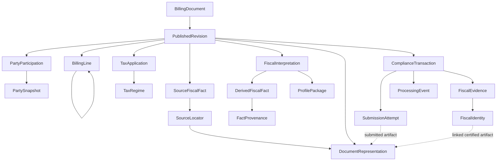
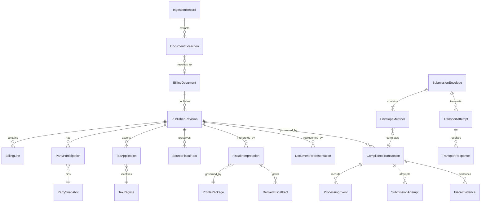

# CTC-003 — Unified D2 Semantic Entity Dictionary

**Version:** Draft 0.5 · **Date:** 2026-10-20 · **Status:** PROPOSED, NOT APPROVED  
**Scope:** End-to-end logical semantic entities and references; no physical schema, API or jurisdictional compliance approval.  
**Task:** CTC-003 (In Progress) · **Supersedes as working draft:** Draft 0.4 (retained for traceability).

## 0. Sources, authority and evidence limits

**Accepted architectural baseline:** D2 nine-concept logical contract, CTC-002 P1–P7, I-01–I-10, and CTC-003 T01/T02/T03 at their explicitly approved *logical* scopes. This document **does not approve** the detailed attributes/cardinalities below. The full approved invariant wording is maintained in `DECISIONS.md` and the D2 formal contract; it is not redefined here.

**Source material:** CTC-003 Commercial Draft 0.2; Tax/Monetary Draft 0.3; Unified Draft 0.4; Global Semantic Billing Model v0.3; SemanticDocument entity specification v1.0; D2 Formal Logical Contract and Peppol mapping review; prior Mexico CFDI, Italy SdI, France, Malaysia and India focused reviews. Some are synthetic/constructed fixtures. **No new regulatory verification, real-payload conformance testing or remote GitHub HEAD verification was conducted for Draft 0.5.** Source-specific fields below are candidate abstractions, not legal assertions.

**Design conventions:** `1` required; `0..1` optional; `0..N` collection; `1..N` nonempty collection. These are **logical candidate cardinalities**, qualified by lifecycle/document type/profile. `Ref` means stable logical identity, not an FK or embedded-vs-independent implementation. A `Snapshot` is frozen historical meaning; a `Projection` is not authoritative. Every `CodedValue` carries scheme and version when meaningful. All monetary calculations use exact decimals, no floating point.

## 1. Ownership and canonical relationships

| Concern | Authoritative logical owner | Not authoritative here |
|---|---|---|
| Platform document identity | BillingDocument | Supplier invoice number or submission ID |
| As-issued business facts | PublishedRevision | Mutable document-root current view |
| Printed/issued party facts | PartySnapshot + scoped PartyParticipation | ERP master-data record |
| Tax regime identity | TaxRegime | Individual tax amount |
| Scoped tax amounts and calculations | TaxApplication | TaxSummary copied as another application |
| Source fiscal classification | SourceFiscalFact (or direct as-issued fact with linked provenance) | DerivedFiscalFact |
| Versioned fiscal classification | DerivedFiscalFact in FiscalInterpretation | SourceFiscalFact overwritten in place |
| Governing immutable rule package | ProfilePackage | Mutable 'latest' profile label |
| Original/generated/submitted bytes | DocumentRepresentation | BillingDocument normalized projection |
| Compliance operation and outcomes | ComplianceTransaction + ProcessingEvent | PublishedRevision status |
| Authority fiscal identity and receipts | FiscalIdentity / FiscalEvidence | SubmissionAttempt identifier |
| Source tax subtotal | SourceAssertion linked to TaxSummary grouping | Derived TaxSummary |

**Important anti-duplication rule:** source classification values may be referenced by both a tax application and a fiscal interpretation, but must not become independently editable authoritative copies. An identical field value in a target representation is an output projection, not a second semantic owner.

## 2. D2 nine-concept traceability

| Approved D2 concept | Detailed candidate decomposition | Boundary note |
|---|---|---|
| BillingDocument | BillingDocument, PublishedRevision, PartySnapshot/Participation, BillingLine, TaxApplication, MonetaryTotal, DocumentRelationship | PublishedRevision is part of the accepted logical D2 set, not a physical root decision |
| PublishedRevision | Revision identity, frozen commercial/tax facts, source fiscal references | Publication trigger remains open |
| SourceFiscalFact | Typed source fact, SourceLocator, FactProvenance, SourceAssertion | Original value preserved; not every commercial field must be duplicated as a SourceFiscalFact |
| FiscalInterpretation | Interpretation identity, DerivedFiscalFact, ProfilePackageRef, input references | Multiplicity capability proposed; embedded/independent physical design deferred |
| DerivedFiscalFact | Value, semantic concept, derivation chain, rule/code-list package refs | May have zero source fiscal inputs when an explicitly captured external enrichment input is used |
| ProfilePackage | ProfileRelease, RulePackageRef, MappingPackageRef, CodeListPackageRef, immutable digest | Published package bytes and dependencies required for replay |
| DocumentRepresentation | Artifact, syntax, format/profile, digest, source/target lineage, role | Original and certified representations distinct |
| ComplianceTransaction | SubmissionAttempt, ProcessingEvent, ValidationFinding, ExternalResponseArtifactRef | Operational details are boundary definitions for CTC-013/014, not implementation approval |
| FiscalIdentity/Evidence | FiscalIdentity, FiscalEvidence, evidence/artifact links | Externally assigned identity distinct from transmission identity |

## 3. Commercial and monetary model retained from Draft 0.4

Draft 0.4 is the full source of the proposed commercial and tax entity catalogue; this section states the **consolidated working contract** and fixes reference ownership for the newly detailed D2 entities. All names and cardinalities remain candidate.

| Entity | Candidate identity / essential attributes | Candidate relationships / constraints |
|---|---|---|
| BillingDocument | `documentId: Identifier (1)`, `tenantRef: Ref (1)` | `PublishedRevision 0..N`; stable identity; no mutable authority status |
| PublishedRevision | `revisionId (1)`, `documentRef (1)`, `revisionLabel (1)`, `documentNumber (1*)`, `documentType (1*)`, `issueDate (1*)`, `documentCurrency (1*)`, `publishedAt (1)`, `modelVersion (1)`, `contentDigest (1)` | 1 document; lines, parties, totals, tax, references; `*` conditional for ordinary published invoices |
| PartySnapshot | `partySnapshotId (1)`, names, identifiers, tax registrations, legal registrations, addresses | `PartyParticipation 0..N`; never resolve historical fields from mutable party master |
| PartyParticipation | `role (1)`, `scopeRef (1)`, `partySnapshotRef (1)` | Header or line scope; seller/buyer constraints profile-specific |
| BillingLine | `lineId (1)`, `lineRole (1)`, `parentLineRef (0..1)`, `contributesToTotals (1)`, `netAmount (0..1)` | Parent in same revision; acyclic; GROUP/DETAIL hierarchy and signed values |
| Item / Quantity / Price | Description/classifications; decimal + unit; price and base quantity | 0..1 per line candidates; inclusion/adjustment semantics from T03 |
| Adjustment | `adjustmentId (1)`, `scopeRef (1)`, `kind (1)`, `amount (1)`, `reason (0..1)` | 0..N at price/line/document; signed meaning must not be inferred from kind alone |
| DocumentRelationship | `relationshipId (1)`, `sourceRevisionRef (1)`, `targetDocumentRef or externalReference (1)`, `relationshipType (1)` | Corrections/credits/replacements are typed links, not mutations of cleared document |
| Supply / Period / TaxPoint | Source supply facts, start/end, date/basis | Applicable scope explicit; single authoritative TaxPoint concept |
| PaymentMeans / PaymentTerms | Means, account refs, dates/terms | 0..N per revision candidate |
| TaxRegime | `regimeId (1)`, `scheme (1)`, `jurisdiction (0..1)`, `taxKind (1)` | 0..N per revision; identity only (T01) |
| TaxApplication | `applicationId (1)`, `regimeRef (1)`, `economicScopeRef (1)`, `taxCategory (0..1)`, `taxMagnitude (0..1)`, `direction (0..1)`, `calculationMethod (0..1)`, `rate (0..1)` | One regime and scope; source assertions and derived effects separately identified (T01/T03) |
| TaxSummary | `groupKey (1)`, `calculatedTax (0..1)`, `sourceAssertionRefs (0..N)`, `reconciliationRef (0..1)` | Derived aggregation; never double count source subtotals (T02) |
| MonetaryTotal | `currency (1)`, as-issued asserted totals (profile-conditional) | Preserve source assertions separately from calculated comparison |
| MonetaryBasis / MonetaryEffect | Basis inclusion, currency, scope; signed contribution relative to basis | **Candidate logical concepts only**; no required fields/cardinality approved (T03) |
| MonetaryConversion / ReconciliationResult | Rate/source/date; assertion/computed/variance/outcome | No unqualified cross-currency addition; `NOT_EVALUABLE` on missing mandatory inputs |

## 4. Fiscal source and derivation entities — detailed dictionary

### FIS-01 SourceFiscalFact

A source-supplied local fiscal fact, not a calculated tax application or external certification outcome. **Candidate logical fields:**

| Attribute | Type | Card. | Proposed invariant |
|---|---|---|---|
| `sourceFactId` | OpaqueIdentifier | 1 | Stable in a published revision |
| `revisionRef` | PublishedRevisionRef | 1 | Exact frozen revision |
| `semanticConcept` | SemanticConceptRef | 1 | Canonical concept name, not an XML XPath |
| `originalValue` | TypedValue | 1 | Exact interpreted source lexical form recoverable from source artifact |
| `valueType` | ValueType | 1 | STRING / DECIMAL / DATE / CODE / BOOLEAN / etc. |
| `codeScheme` | SchemeRef | 0..1 | Required for coded facts where known |
| `codeSchemeVersion` | VersionRef | 0..1 | If unavailable, record unknown rather than invent |
| `sourceLocatorRef` | SourceLocatorRef | 1..N | Exact source artifact + path or equivalent location |
| `observedAt` | Instant | 0..1 | Ingestion observation, not legal issue date |
| `origin` | FactOrigin | 1 | SOURCE_SUPPLIED; other origins belong in derivation/enrichment records |

**Constraint:** a direct as-issued commercial field may itself be authoritative on PublishedRevision and have a linked provenance record; avoid duplicating every commercial field as another authoritative SourceFiscalFact. Use SourceFiscalFact specifically for local fiscal semantics not already fully represented by a shared billing concept.

### FIS-02 FiscalInterpretation

Immutable result of applying one identifiable fiscal profile to one exact revision. **Candidate fields:**

| Attribute | Type | Card. | Proposed invariant |
|---|---|---|---|
| `interpretationId` | OpaqueIdentifier | 1 | Stable logical identity; materialization strategy deferred |
| `revisionRef` | PublishedRevisionRef | 1 | Pinned exact revision |
| `revisionDigest` | DigestRef | 1 | Historical reproducibility check |
| `profilePackageRef` | ProfilePackageRef | 1 | Immutable package identity |
| `purpose` | CodedValue | 1 | Fiscal meaning/target obligation, not transport endpoint alone |
| `jurisdiction` | JurisdictionRef | 1 | Country and optional subdivision, as applicable |
| `derivedFactRefs` | DerivedFiscalFactRef | 0..N | Does not overwrite source facts |
| `inputFactRefs` | FactRef | 0..N | May include billing facts and external enrichment snapshots |
| `evaluatedAt` | Instant | 1 | Evaluation time distinct from document issue date |
| `resultDigest` | DigestRef | 1 | Canonicalization scheme/version must be pinned |
| `interpretationState` | CodedValue | 0..1 | VALID / INCOMPLETE / NOT_EVALUABLE etc.; not authority clearance status |

**Cardinality hypothesis:** PublishedRevision → FiscalInterpretation `0..N` logical capability; **not** approval of separate aggregate roots, default snapshot location or one interpretation per destination.

### FIS-03 DerivedFiscalFact

| Attribute | Type | Card. | Proposed invariant |
|---|---|---|---|
| `derivedFactId` | OpaqueIdentifier | 1 | Stable within interpretation |
| `interpretationRef` | FiscalInterpretationRef | 1 | One owning interpretation |
| `semanticConcept` | SemanticConceptRef | 1 | Same semantic path across A/B/C/D2 representations |
| `derivedValue` | TypedValue | 1 | Explicit typed value, including scheme for coded results |
| `derivationKind` | DerivationKind | 1 | MAPPED / CALCULATED / INFERRED / ENRICHED / MANUAL_OVERRIDE |
| `inputRefs` | FactOrSnapshotRef | 0..N | Zero only for explicit constant rule with documented context; otherwise trace inputs |
| `ruleRef` | VersionedRuleRef | 1 | Exact immutable rule |
| `codeListRef` | VersionedCodeListRef | 0..1 | Required when lookup code-list governs value |
| `explanation` | Text | 0..1 | Human-readable rationale; not replacement for machine provenance |

**Constraint:** if a derived value contradicts a source assertion, retain both and record a validation finding; never rewrite the source fact. For enrichment or manual override, preserve who/what supplied the additional input and its timestamp, scope and evidence.

### PROV-01 SourceLocator and PROV-02 FactProvenance

| Entity | Essential candidate fields | Relationships / constraints |
|---|---|---|
| SourceLocator | `locatorId (1)`, `representationRef (1)`, `pathScheme (1)`, `path (1)`, `occurrenceIndex (0..1)`, `lexicalValue (0..1)` | Path scheme: XPath/JSON Pointer/CSV column or equivalent; must reference immutable source artifact |
| FactProvenance | `provenanceId (1)`, `factRef (1)`, `origin (1)`, `inputRefs (0..N)`, `mappingRef (0..1)`, `ruleRef (0..1)`, `profileRef (0..1)`, `externalSnapshotRef (0..N)` | One authoritative fact may have many evidence links, but no competing authoritative value |
| EnrichmentSnapshot | `snapshotId (1)`, `providerRef (1)`, `observedAt (1)`, `inputDigest (1)`, `outputDigest (1)`, `artifactRef (1)` | Candidate supporting record for deterministic replay of external lookups |

## 5. Profile and extension entities

### PROF-01 ProfilePackage

| Attribute | Type | Card. | Proposed invariant |
|---|---|---|---|
| `profilePackageId` | Identifier | 1 | Immutable release identity |
| `jurisdiction` | JurisdictionRef | 1 | Country/region/municipality where applicable |
| `profileCode` | CodedValue | 1 | Mandate/business process identity, not invoice number |
| `releaseVersion` | VersionRef | 1 | Human-readable version alone insufficient for replay |
| `packageDigest` | DigestRef | 1 | Content-addressed or equivalently immutable |
| `rulePackageRefs` | ImmutableArtifactRef | 0..N | Exact rule bytes/versions |
| `mappingPackageRefs` | ImmutableArtifactRef | 0..N | Exact mapping bytes/versions |
| `codeListPackageRefs` | ImmutableArtifactRef | 0..N | Exact code-list bytes/versions |
| `validationPackageRefs` | ImmutableArtifactRef | 0..N | Exact validation rule set |
| `effectiveFrom` / `effectiveTo` | Date | 0..1 each | Effective-dating; no invented legal dates |
| `dependencies` | ImmutableArtifactRef | 0..N | Engine/schema/runtime version when replay requires it |

**Separate concepts:** `JurisdictionProfile` may represent a governed logical policy family; `ProfilePackage` represents an immutable executable/reproducible release. The precise split is a **candidate** and belongs to CTC-005/007. `JurisdictionExtension` remains a governed namespaced concept with its own schema, version and validation rules; not an unvalidated escape hatch.

## 6. Representation and attachment entities

### REP-01 DocumentRepresentation

| Attribute | Type | Card. | Proposed invariant |
|---|---|---|---|
| `representationId` | Identifier | 1 | Stable immutable artifact identity |
| `documentRevisionRef` | PublishedRevisionRef | 0..1 | Some inbound draft artifacts precede publication; correlation still required |
| `interpretationRef` | FiscalInterpretationRef | 0..1 | Generated target artifact may pin interpretation |
| `representationRole` | CodedValue | 1 | SOURCE / NORMALIZED / GENERATED / SUBMITTED / CERTIFIED / RESPONSE |
| `syntaxFamily` | CodedValue | 1 | XML / JSON / CII / UBL / etc.; taxonomy governance open |
| `formatIdentifier` / `formatVersion` | String / VersionRef | 1 / 0..1 | Actual source or target syntax version |
| `customizationId` / `processProfileId` | String | 0..1 each | Interchange/profile metadata, not commercial identity |
| `artifactRef` | ImmutableArtifactRef | 1 | Original bytes or canonical serialization accessible |
| `contentDigest` / `digestAlgorithm` | Digest / Code | 1 each | Hash verification with algorithm |
| `mappingPackageRef` | ImmutableArtifactRef | 0..1 | Required when generated through mapping |
| `createdAt` | Instant | 1 | Processing timestamp, not document issue date |
| `parentRepresentationRefs` | RepresentationRef | 0..N | Explicit transformation/certification lineage |

**Nuance:** `RESPONSE` is a representation of a response message and may refer to an operation rather than a published revision. This is a logical shared artifact concept, not a mandate to store every artifact in one table. Do not treat certification as merely a status flag on the pre-certified representation.

### REP-02 AttachmentReference

`attachmentRef (1)`, `linkedScopeRef (1)`, `purpose (0..1)`, `filename (0..1)`, `mediaType (0..1)`, `representationRef (1)`; 0..N per published revision. Original content remains in an immutable artifact, not in an unchecked extension bag. Attachment types, sizes, privacy and legal retention are deferred.

## 7. Compliance and response entities — boundary dictionary

These concepts are **logical interface boundaries only**; full workflow/event state machine belongs to CTC-013 and normalized response taxonomy to CTC-014.

### COMP-01 ComplianceTransaction

| Attribute | Type | Card. | Proposed invariant |
|---|---|---|---|
| `complianceTransactionId` | Identifier | 1 | Logical obligation/operation, not an invoice number |
| `revisionRef` | PublishedRevisionRef | 1 | Exact immutable commercial revision |
| `interpretationRef` | FiscalInterpretationRef | 0..1 | If used, must pin exact interpretation; no 'latest' |
| `submittedRepresentationRef` | DocumentRepresentationRef | 0..1 | Required by the submission operation when one is sent |
| `jurisdiction` | JurisdictionRef | 1 | Destination compliance scope |
| `obligationType` | CodedValue | 1 | CLEARANCE / REPORTING / DELIVERY / etc. candidate taxonomy |
| `destinationRef` | DestinationRef | 0..1 | Endpoint/provider identity is not fiscal identity |
| `createdAt` | Instant | 1 | Internal operation time |
| `eventRefs` | ProcessingEventRef | 0..N | Append-only; status derived/projected |

**I-04 alignment:** a **submitted** operation must pin exact interpretation and representation references when interpretation applies; optional fields above cover pre-submission states and operations with no fiscal interpretation. Do not allow submitted operations to resolve a mutable current profile.

### COMP-02 SubmissionAttempt

`attemptId (1)`, `complianceTransactionRef (1)`, `attemptOrdinal (1)`, `outboundRepresentationRef (1)`, `providerRef (0..1)`, `externalTransmissionId (0..1)`, `submittedAt (0..1)`, `responseArtifactRefs (0..N)`, `attemptOutcome (0..1)`; transaction → attempts `0..N`. An uncertain remote outcome is distinct from a rejection; retry must not erase original attempt. Exact idempotency policy deferred.

### COMP-03 ProcessingEvent

`eventId (1)`, `transactionRef (1)`, `attemptRef (0..1)`, `eventType (1)`, `occurredAt (0..1)`, `observedAt (1)`, `sourceSystem (0..1)`, `originalResponseRef (0..1)`, `correlationRefs (0..N)`, `payloadRef (0..1)`; transaction → events `0..N`. Event append-only; issuance, authority decision, delivery and recipient acceptance must not collapse to one status dimension.

### COMP-04 ValidationFinding

`findingId (1)`, `scopeRef (1)`, `ruleRef (0..1)`, `severity (1)`, `message (1)`, `sourcePathRef (0..1)`, `authorityCode (0..1)`, `outcome (1)`; `0..N` per validation or processing operation. Validation failure does not silently change commercial facts.

### COMP-05 ResponseCorrelation

`correlationId (1)`, `transactionRef (1)`, `attemptRef (0..1)`, `externalReference (0..1)`, `responseRepresentationRef (1)`, `matchedAt (0..1)`, `matchConfidence (0..1)`; a response may arrive late or duplicated. Whether response correlation is a separate entity is deferred to CTC-014.

## 8. Fiscal identity and evidence entities

### EVD-01 FiscalIdentity

| Attribute | Type | Card. | Proposed invariant |
|---|---|---|---|
| `fiscalIdentityId` | Identifier | 1 | Internal identity record |
| `identityType` | CodedValue | 1 | FISCAL_UUID / AUTHORIZATION_CODE / FISCAL_SEQUENCE etc. |
| `identityValue` | String | 1 | Authority-provided value preserved |
| `issuingAuthorityRef` | AuthorityRef | 1 | Issuer/assigner of fiscal identity |
| `jurisdiction` | JurisdictionRef | 1 | Scope of identity |
| `documentRevisionRef` | PublishedRevisionRef | 1 | Commercial revision related to fiscal artifact |
| `certifiedRepresentationRef` | DocumentRepresentationRef | 0..1 | Required when identity is conferred on a certified artifact |
| `complianceTransactionRef` | ComplianceTransactionRef | 0..1 | Originating process when applicable |
| `assignedAt` | Instant | 0..1 | Actual authoritative time, not observation time |

**No conflation:** commercial `documentNumber`, external `transmissionId`, and fiscal `identityValue` remain distinct. `FiscalIdentity` is the authoritative typed record; `FiscalEvidence` may reference it but must not independently redefine the identity.

### EVD-02 FiscalEvidence

`evidenceId (1)`, `evidenceType (1)`, `relatedTransactionRef (0..1)`, `relatedFiscalIdentityRef (0..1)`, `artifactRef (1)`, `contentDigest (1)`, `issuingAuthorityRef (0..1)`, `issuedAt (0..1)`, `observedAt (1)`, `supersedesRef (0..1)`, `revokesRef (0..1)`; transaction → evidence `0..N`. Revocation and cancellation are new events/evidence; previously authorized artifacts remain historically identifiable.

## 9. Shared logical value types

| Value type | Required semantics | Anti-pattern |
|---|---|---|
| Identifier / Reference | Opaque identity, namespace, stable target | Reusing supplier invoice number as primary platform ID |
| CodedValue | Code + scheme + scheme version/issuer where known | Bare code assumed universal |
| Decimal | Exact base-10 value and declared precision | Binary float for tax arithmetic |
| Money | Decimal amount + currency; original sign preserved | Implicit currency or forced two decimal places |
| Rate | Decimal rate + unit (`PERCENT`, `FRACTION`, `PER_UNIT`) | Treating CFDI `0.160000` as 0.16% |
| Quantity | Decimal + unit scheme/code | Unlabelled numeric quantities |
| Date / Instant | Date-only vs offset-aware timestamp; origin/time zone known | Inferring issue date from ingestion timestamp |
| SemanticText | Text + optional language/structured notes | Destroying multilingual source meaning |
| DigestRef | Algorithm, canonicalization scheme/version when computed from semantics | Comparing digests from different canonicalizers |
| SourceLocator | Immutable artifact ID + location expression + scheme | Mutable XPath with no pinned source bytes |
| JurisdictionRef | Country + optional subnational scope + governing code scheme | Assuming country-only routing for all regimes |

## 10. Logical relationship map



**Diagram limitation:** edges indicate semantic references, not containment, transaction boundaries, table foreign keys or physical cardinalities. Do not infer one aggregate per node. `BillingLine --> BillingLine` denotes optional parent/child relation, constrained to an acyclic hierarchy.

## 11. End-to-end conceptual example (not a validated country payload)

```yaml
billingDocument:
  documentId: DOC-001
publishedRevision:
  revisionId: REV-001
  documentRef: DOC-001
  documentNumber: INV-1001
  documentType: INVOICE
  issueDate: 2026-10-20
  documentCurrency: XXX
  sourceFiscalFactRefs: [SF-001]
sourceFiscalFact:
  sourceFactId: SF-001
  semanticConcept: fiscal.taxTreatmentCode
  originalValue: LOCAL-TAX-A
  codeScheme: XX-TAX-SCHEME
  sourceLocatorRef: LOC-001
sourceLocator:
  locatorId: LOC-001
  representationRef: REP-001
  pathScheme: JSON_POINTER
  path: /taxCode
fiscalInterpretation:
  interpretationId: FI-001
  revisionRef: REV-001
  profilePackageRef: PKG-001
  derivedFactRefs: [DF-001]
derivedFiscalFact:
  derivedFactId: DF-001
  semanticConcept: tax.treatment
  derivedValue: STANDARD
  derivationKind: MAPPED
  inputRefs: [SF-001]
  ruleRef: RULE-001@1
profilePackage:
  profilePackageId: PKG-001
  releaseVersion: 1.0.0
  packageDigest: sha256:EXAMPLE_NOT_REAL
representation:
  representationId: REP-001
  representationRole: SOURCE
  syntaxFamily: JSON
  artifactRef: ART-001
  contentDigest: sha256:EXAMPLE_NOT_REAL
complianceTransaction:
  complianceTransactionId: CT-001
  revisionRef: REV-001
  interpretationRef: FI-001
  submittedRepresentationRef: REP-002
  obligationType: CLEARANCE
fiscalIdentity:
  fiscalIdentityId: FID-001
  identityType: FISCAL_UUID
  identityValue: FICTIONAL-UUID
  documentRevisionRef: REV-001
  certifiedRepresentationRef: REP-003
```

The example intentionally omits many mandatory attributes and uses fictional values; it is an **illustration of reference topology**, not a valid instance of the complete candidate dictionary or any country's invoice schema.

## 12. Reconciliation and decision matrix

| Issue | Proposed treatment in Draft 0.5 | Status / owning task |
|---|---|---|
| DOC number/type/date at root and revision | Authoritative on published revision; root projections only | Proposed; CTC-006 |
| Party master vs as-issued party | Freeze PartySnapshot at publication | Proposed; CTC-006 |
| GROUP/DETAIL lines double counting | Explicit contribution flag and same-revision acyclic parent graph | Proposed; CTC-003/004 |
| TaxPoint duplicate definitions | Single shared TaxPoint concept; source versus local interpretation split | Proposed; CTC-003/005 |
| TaxRegime / TaxApplication | Distinct regime and scoped application | **T01 accepted logically**; detailed shape proposed |
| TaxSummary source vs derived | Preserve source assertions; derive grouped summary and reconcile | **T02 accepted logically**; detailed shape proposed |
| MonetaryBasis / MonetaryEffect | Candidate value objects; no required materialization | **T03 accepted policy**; detailed shape deferred DES01 |
| SourceFiscalFact duplication | Use as authoritative local source fiscal fact; commercial source fields have provenance without duplication | Proposed; P6/P7 constraint |
| FiscalInterpretation identity/multiplicity | Stable reference and immutable evaluated result; 0..N logical capability candidate | Proposed; physical A/B/C deferred FU01 |
| ProfilePackage vs JurisdictionProfile | Immutable executable release versus logical governed profile | Proposed; CTC-005/007 |
| SourceLocator vs mapping lineage | Artifact location vs transformation/derivation chain | Proposed; CTC-003/012 |
| Response representation and document revision | Response may attach to compliance transaction without a published revision | Proposed; CTC-013/014 |
| FiscalIdentity vs FiscalEvidence | One typed authoritative fiscal ID; evidence references identity and artifact | Proposed; CTC-002-FU05/CTC-013 |
| Status dimensions | Issuance, clearance, delivery, recipient outcome, cancellation separate | Proposed; CTC-013 |
| Original extension bag | Namespaced governed extension with schema, profile and provenance; no unchecked required fields | Proposed; CTC-005 |

## 13. CTC-003 completion gates and evidence gaps

**Deliverable coverage now:** all nine approved D2 logical categories have a proposed detailed dictionary and a single cross-domain relationship diagram. This is **structural completeness**, not approved schema or regulatory completeness.

**Before CTC-003 can be marked Done:**

1. Review and resolve the high-impact proposed ownership rules (revision identity, PartySnapshot, FiscalInterpretation references, SourceFiscalFact provenance and FiscalIdentity ownership).
2. Specify conditional cardinality and nullability for invoice, credit note, correction, debit note and other supported document families; do not declare universal seller/buyer/line requirements.
3. Resolve candidate `MonetaryBasis`/`MonetaryEffect` shape and overlapping `ReconciliationResult` / `MonetaryReconciliation` names, or explicitly defer with a compatibility plan.
4. Add model-to-source traceability for fields in v1.0 and v0.3 and classify lossless/split/derived/native-only/unmapped mappings (CTC-009 can own exhaustive mapping).
5. Supply internally consistent *complete* semantic examples and validate references/cardinalities against the candidate dictionary; no fabricated legal correctness claims.
6. Obtain explicit user approval of the detailed dictionary scope; do not infer acceptance from accepted D2 concepts or T01/T02/T03.

**Deferred evidence (not a reason to invent fields):** official full XML/XSD/Schematron validations; paired CFDI certification; Italian SdI response pairs; real French Extended CTC profile; MyInvois and India IRP full conformance; real multiple fiscal interpretations. See CTC-002-FU02..FU04, CTC-003-EV01..EV05 and CTC-008/009/010.

**Suggested next review:** prioritize (a) document/revision/party identity, (b) fiscal interpretation source ownership, (c) exact compliance-to-artifact correlation, then approve or revise Draft 0.5 before producing Draft 0.6 examples.


---
# Draft 1.3 Completion-Candidate Addendum — Normative Review Boundary

**Status:** PROPOSED detailed semantic dictionary; NOT an approved schema or task closure. **Date:** 2026-10-20. This addendum integrates Drafts 0.5–1.2; earlier drafts remain as evidence and are not silently superseded as approved contracts. This candidate reuses the detailed 0.5 dictionary above and adds batch, lifecycle, conditional cardinality, examples, and review gates below.

## A. Decision precedence and scope

- **Accepted logical baseline:** D2 nine logical concepts; P1–P7; I-01–I-10; T01–T03; D01–D03; L01–L10; BATCH-01; B01–B10; C09-01 through C09-08, each **only with qualifications in DECISIONS.md**.
- **Not accepted:** all detailed attribute shapes and nullability, physical fiscal-context A/B/C, named aggregate roots or tables, jurisdiction-specific issuance/validation, regulatory fixture conformance, and this consolidated dictionary.
- **Evidence:** structural Python checks using synthetic instances, constructed Peppol/CFDI/MyInvois/India mappings, source-based research. No production authority batch acceptance test or comprehensive XSD/Schematron conformance is claimed.

## B. Additional transport and lifecycle entity dictionary

| ID | Candidate entity | Identity and minimum logical fields | Candidate associations and rules | Approval status |
|---|---|---|---|---|
| ING-01 | IngestionRecord | ingestionId, tenantRef, receivedAt, sourceArtifactRefs, channelRef | completed external reception retains >=1 immutable artifact; 0..N extractions | entity shape proposed; C09-01/02 logical accepted |
| ING-02 | DocumentExtraction | extractionId, ingestionRef, sourceMemberLocator, extractionDigest, resolutionState | exactly one ingestion; 0..1 BillingDocument resolution; no implicit legal identity | shape proposed |
| ING-03 | WorkingDocument | workingId, ingestion/extractionRefs, validationState, optional documentRef | 0..N working versions before publication; never called PublishedRevision | shape and multiplicity proposed |
| ENV-01 | SubmissionEnvelope | envelopeId, destinationRef, memberManifestDigest, representationRef | 1..N immutable member references for a multi-member submitted envelope; empty draft allowed | shape proposed; B05 logical accepted |
| ENV-02 | EnvelopeMember | memberId, envelopeRef, complianceTransactionRef, revisionRef, representationRef | unique member identity within envelope; independently correlated outcome | shape proposed |
| ENV-03 | TransportAttempt | attemptId, envelopeRef, outboundPayloadRef, submittedAt?, correlationRefs | one exact immutable payload when submitted; retries create new attempt | shape proposed; C09-07 logical accepted |
| ENV-04 | TransportResponse | responseId, attemptRef?, rawRepresentationRef, receivedAt, responseSubject | subject ENVELOPE or MEMBER; unresolved correlation stays UNKNOWN | shape proposed |
| CMP-01 | LegalStateAssessment | assessmentId, revisionRef, regime/profileRef, evidenceRefs, evaluatedAt, outcome | distinct from transport status; no unsupported legal-state inference | shape proposed; L04/05 and C09-08 logical accepted |
| CMP-02 | SubmissionSnapshot | snapshotId, revisionDigest, interpretationRef?, outboundArtifactDigest, destinationRef | exact immutable submission basis; physical record optional | shape proposed; D03 logical accepted |
| ID-01 | DuplicateResolution | resolutionId, ingestionRefs, candidateDocumentRefs, matchingBasis, result | repeated reception != duplicate legal invoice != idempotent submission | shape proposed |

## C. Conditional cardinality matrix (accepted logical constraints, candidate physical links)

| Rule | Context | Logical constraint | Non-goal |
|---|---|---|---|
| C09-01 | Completed external reception | 1..N immutable original artifact references | Does not require external source for internally created documents |
| C09-02 | Ingestion | 0..N extractions; extraction resolves to 0..1 BillingDocument | Does not infer invoice identity from matching bytes |
| C09-03 | BillingDocument | 0..N PublishedRevision; >=1 after first platform publication | Publication != legal issuance |
| C09-04 | Revision | Globally 0..N parties and lines; document-family/profile imposes minimums | Not a claim that an issued invoice can omit seller |
| C09-05 | Published participation | Exactly one immutable PartySnapshot | Does not prescribe party-master storage |
| C09-06 | Revision | 0..N FiscalInterpretation, each pinned to exact revision and immutable inputs | Not mandatory separate FiscalContext aggregate |
| C09-07 | Submitted attempt | One immutable payload, 1..N member references for multi-member envelope | Does not imply envelope receipt clears all members |
| C09-08 | Revision / compliance transaction | 0..N legal assessments and 0..N typed processing events | Evidence need not be an authority receipt in every regime |

## D. Unified conceptual relationship diagram



**Diagram qualification:** Mermaid cardinalities are candidate navigability, not database foreign keys or universal publication requirements. For example, a draft envelope may have zero members; a submitted multi-member envelope must have at least one. Response subject may be envelope or member.

## E. Representative logical instances (synthetic, non-regulatory)

### E1 — Standard invoice

```yaml
billingDocument: {documentId: DOC-100}
publishedRevision:
  revisionId: REV-100
  documentRef: DOC-100
  documentNumber: INV-100
  documentType: INVOICE
  currency: EUR
  partyParticipations:
    - {role: SELLER, partySnapshotRef: PARTY-S-100}
    - {role: BUYER, partySnapshotRef: PARTY-B-100}
  lines:
    - {lineId: L1, lineRole: DETAIL, contributesToTotals: true, netAmount: '100.00'}
  taxApplications:
    - {applicationId: TAX-1, regimeRef: VAT-XX, economicScopeRef: L1, taxMagnitude: '20.00'}
  assertedTotals: {taxExclusive: '100.00', taxInclusive: '120.00'}
```

### E2 — Credit note linked to invoice

```yaml
billingDocument: {documentId: DOC-101}
publishedRevision: {revisionId: REV-101, documentRef: DOC-101, documentType: CREDIT_NOTE, documentNumber: CN-101}
documentRelationship: {type: CREDITS, sourceRevisionRef: REV-101, targetDocumentRef: DOC-100}
monetaryPolicy: {presentationAndEconomicEffectSeparate: true}
```

### E3 — Multiple tax regimes on one invoice

```yaml
publishedRevision: {revisionId: REV-102, documentRef: DOC-102}
taxRegimes: [{regimeId: TAX-A}, {regimeId: TAX-B}]
taxApplications:
  - {applicationId: APP-A, regimeRef: TAX-A, economicScopeRef: LINE-1, taxMagnitude: '10.00'}
  - {applicationId: APP-B, regimeRef: TAX-B, economicScopeRef: LINE-1, taxMagnitude: '5.00'}
taxSummary: {role: DERIVED_RECONCILED, applications: [APP-A, APP-B]}
```

### E4 — French-style grouped/explanatory lines

```yaml
publishedRevision: {revisionId: REV-103, documentRef: DOC-103}
lines:
  - {lineId: GROUP-10, lineRole: GROUP, contributesToTotals: true, netAmount: '21425.59'}
  - {lineId: DETAIL-11, lineRole: DETAIL, parentLineRef: GROUP-10, contributesToTotals: false, netAmount: '21425.59'}
  - {lineId: GROUP-20, lineRole: GROUP, contributesToTotals: true, netAmount: '-204.78'}
calculatedContributingLineTotal: '21220.81'
```

### E5 — Partial batch acceptance and retry

```yaml
ingestion: {ingestionId: ING-1, extractions: [EXT-1, EXT-2]}
extractions:
  - {extractionId: EXT-1, documentRef: DOC-100}
  - {extractionId: EXT-2, documentRef: DOC-101}
envelope: {envelopeId: ENV-1, members: [MEM-1, MEM-2], manifestDigest: SHA256-EXAMPLE}
members:
  - {memberId: MEM-1, complianceTransactionRef: CT-100, revisionRef: REV-100}
  - {memberId: MEM-2, complianceTransactionRef: CT-101, revisionRef: REV-101}
transportAttempt: {attemptId: ATT-1, envelopeRef: ENV-1, outboundPayloadRef: REP-ENV-1}
memberResponses:
  - {subject: MEM-1, outcome: ACCEPTED}
  - {subject: MEM-2, outcome: REJECTED}
retry: {attemptId: ATT-2, reason: CORRELATION_OR_TECHNICAL_RETRY, newAttempt: true}
```

## F. Traceability to source models

| Earlier SemanticDocument v1.0 | BillingDocument v0.3 | Candidate Draft 1.3 | Disposition |
|---|---|---|---|
| SemanticDocument / DocumentIdentity | BillingDocument | BillingDocument + PublishedRevision | Split stable identity from published facts; approved logical principle, fields proposed |
| SemanticParty | Party / FiscalPartyContext | PartySnapshot + PartyParticipation + SourceFiscalFact | Refined; snapshot and role distinctions |
| SemanticLine | BillingLine | BillingLine hierarchy + contribution flag | Refined; signed, grouped/detail retained |
| TaxRegime | Tax type/category | TaxRegime | Retain, T01 accepted |
| TaxApplication | Tax / TaxSummary | TaxApplication | Retain with explicit scope, T01 accepted |
| RegimeTaxTotal / MonetaryTotal | TaxSummary / MonetaryTotal | TaxSummary + SourceAssertion + MonetaryTotal | Split asserted vs derived, T02 accepted |
| DocumentControl | ComplianceTransaction / DocumentRepresentation | ComplianceTransaction + Representation + SubmissionSnapshot | Split processing and source artifacts |
| FormatNativeBag | JurisdictionExtension | SourceFiscalFact + governed extension + raw representation | Replace unrestricted bag with governed preservation; exact migration open |
| SignatureData | Fiscal identifiers / process | FiscalIdentity + FiscalEvidence | Separate identity from evidence and submission |
| MandateScope | JurisdictionProfile | ProfilePackage + JurisdictionRef | Governed, versioned profile |
| No explicit batch container | No explicit batch container | IngestionRecord + SubmissionEnvelope + EnvelopeMember | Added transport separation, BATCH-01 accepted |

**Traceability limitation:** This is entity-level traceability, not a complete field-by-field migration/loss matrix; CTC-009 owns exhaustive field-level coverage.

## G. Closure gate and outstanding decisions

- **G1 — Dictionary completeness:** Each candidate entity needs a precise semantic definition, identifier, ownership, fields/types, nullability, and conditional cardinality. Draft 1.3 covers the principal concepts but some companion/value-object details remain in earlier drafts; this is a review candidate, not final acceptance.
- **G2 — Model coherence:** Resolve overlapping `MonetaryReconciliation` versus `ReconciliationResult`, `TaxPoint` duplicates, submission attempt versus transport attempt, and source fact versus commercial field authoritative ownership.
- **G3 — Instance evidence:** Promote E1–E5 into machine-checkable, versioned semantic fixtures, with negative controls and explicit outcome rules.
- **G4 — Source traceability:** Review entity-level mapping above, then move full field-level loss matrix to CTC-009 with tracked dependencies.
- **G5 — Explicit approval:** User approves detailed dictionary and conditional cardinality implementation scope before marking CTC-003 Done.

**Deferred to other tasks:** CTC-004 tax/regulatory validation; CTC-005 jurisdiction profiles; CTC-006 party/legal correction rules; CTC-007 version compatibility; CTC-008/009/010 real fixtures and coverage; CTC-013/014 provider lifecycle and responses; CTC-002-FU01 physical FiscalContext A/B/C.
