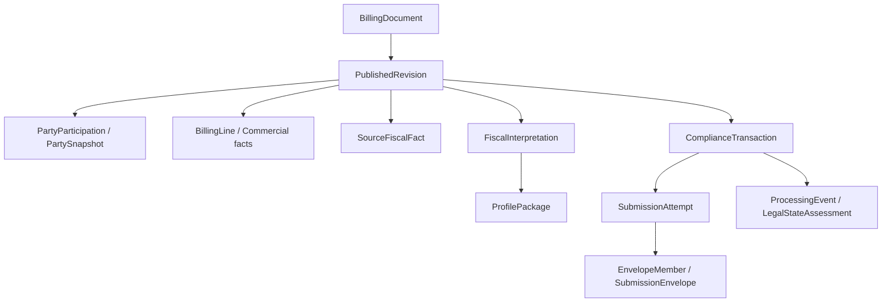

# Global CTC Semantic & Logical Data Model — Technical Design Specification

**Version:** 0.1 (DRAFT)  
**Date:** 2026-10-21  
**Status:** Development-facing working baseline; **not an independently approved implementation specification**  
**Normative source:** `DECISIONS.md`, `MODEL-BASELINE.md` and approved scoped research artifacts; this document cannot override them.  
**Source snapshot:** locally available CTC-014 approved full Git package (2026-10-21) plus explicitly approved CTC-011 logical model package. **Live GitHub HEAD not verified.**

## 1. Purpose and reading rules

This specification provides one entry point for teams building ERP ingestion adapters, the canonical billing/fiscal model, mapping services, compliance workflows and response consumers. It documents **accepted logical behavior** separately from **proposed design details** and **deferred implementation choices**. An `Accepted` rule is normative only within the precise approval scope recorded in `DECISIONS.md`. A `Proposed` attribute is not required by the accepted schema. All country-specific behavior requires versioned profile evidence.

**Maturity labels:** `ACCEPTED (scoped)` = user-approved logical contract; `PROPOSED` = candidate shape/field or design choice; `DEFERRED` = decision tracked elsewhere; `EVIDENCE GAP` = no independent fixture/regulatory validation.

## 2. System objective and boundaries

Ingest ERP/client billing documents and associated representations in different formats; normalize source commercial facts into a controlled semantic contract; apply versioned jurisdictional interpretations and outbound mappings; route compliant payloads to the selected service provider, PA or authority; ingest responses and preserve original evidence; expose evidence-linked normalized outcomes back to the client. No source or target format is presumed universal. This is a logical design, **not a deployed architecture**.

### Logical flow

```mermaid
flowchart LR
 ERP[ERP / Client] --> IN[Inbound adapter / source representation]
 IN --> REV[BillingDocument / PublishedRevision]
 REV --> FISC[Source fiscal facts / versioned interpretation]
 FISC --> OUT[Outbound representation / routing]
 OUT --> EXT[PA / Authority]
 EXT --> OBS[Immutable response observation]
 OBS --> CORR[Typed correlation / event history]
 CORR --> PROJ[Client status projection]
```

## 3. Approved semantic design principles (ACCEPTED — scoped)

- D2's nine logical concepts and I-01–I-10 govern domain ownership; P1–P7 require separation of billing meaning and compliance processing, immutable revisions and representations, independent fiscal/submission identities and compliance histories, single semantic ownership, and source-versus-derived provenance.
- T01–T03 govern scoped tax applications, source assertions versus reconciled summaries, and explicit monetary bases, polarity, signed effects, currency and rounding provenance. `MonetaryBasis` and `MonetaryEffect` remain candidate detailed concepts where not approved as entity shapes.
- D01–D03 govern stable document identity, immutable party snapshots, pinned fiscal interpretation inputs and exact submission/evidence correlation.
- L01–L10 separate preparation, legal/fiscal recognition and compliance operations; publication is not automatically legal issuance.
- Batch and C09/B01–B10 qualified rules separate transport containers from documents and prevent envelope-level success from implying member acceptance.
- JP-01–JP-10 govern versioned profile applicability and extensions; C006-01–03 govern commercial identity namespaces, party snapshots and typed correction relationships; V-01–V-10 govern semantic compatibility.
- CL-01–CL-08 govern append-only compliance history, separate status dimensions and deterministic projections; AR-01–AR-10 govern immutable authority observations and normalized outcomes.

Refer to `DECISIONS.md` for **exact wording, approval limitations and precedence**; these summaries are navigation aids, not replacement ADR text.

## 4. Canonical semantic model (CTC-003 ACCEPTED — scoped)

The approved CTC-003 closure candidate documents **51 logical concepts** and the reviewed identity, ownership, logical-type, nullability and qualified-cardinality framework. The canonical contract is not equivalent to 51 physical tables. Important concept families:

| Family | Logical responsibility | Non-negotiable boundary |
|---|---|---|
| BillingDocument / PublishedRevision | Stable platform identity and immutable published commercial assertions | No mutation of published revision |
| PartySnapshot / PartyParticipation | Exact party values and roles as represented on the document | Do not resolve historical facts from mutable ERP master data |
| BillingLine / commercial facts | Scoped commercial quantities, classifications, pricing and adjustments | Preserve additive versus explanatory hierarchy semantics |
| TaxRegime / TaxApplication / TaxSummary | Tax scheme, application and reconciled aggregation | Do not double-count asserted totals |
| SourceFiscalFact / FiscalInterpretation / DerivedFiscalFact | Source assertion and pinned profile-derived interpretation | Never overwrite source facts |
| ProfilePackage / provenance | Immutable package and complete interpretation inputs | No implicit latest versions |
| DocumentRepresentation | Original and generated byte artifacts with provenance | Preserve exact source and submitted artifacts |
| ComplianceTransaction / attempts / events | Per-obligation processing and immutable history | Separate document and envelope operations |
| FiscalIdentity / FiscalEvidence / response observations | Typed external identities, evidence and authority claims | Do not infer legal status from transport success |

**Detailed field source:** `research/CTC-003/CTC-003-DETAILED-LOGICAL-DICTIONARY-APPROVED-SCOPED.md` (if present in the approved repository). **18 additional CTC-003 field contracts remain PROPOSED.** Their absence must not be silently filled by this TDS.

## 5. Logical relational model (CTC-011 ACCEPTED — scoped)

The logical model comprises **51 mapped concepts**, **24 principal relationships**, and four domain diagrams (`research/CTC-011/01-commercial.mmd`, `02-fiscal.mmd`, `03-compliance.mmd`, `04-ingestion.mmd`). Use `ENTITY-MAPPING.csv` and `RELATIONSHIP-REGISTER.csv` as the exact machine-readable candidate registers approved at logical scope.

**Relational rules:** Each published revision belongs to one platform document; document-scoped assertions and tax applications must resolve to the correct revision; profile-specific role/line minimums are conditional; submitted attempts reference immutable snapshots; envelope member outcomes are independently correlated; unresolved external document references do not create fabricated local documents. A logical relationship lacking a declared reference attribute **must not be treated as a newly approved canonical field or physical FK column**.

**DEFERRED:** Physical keys, tables, indexes, partitions, storage technology, retention and the FiscalContext A/B/C aggregate/persistence choice.

## 6. Tax and monetary behavior (CTC-004 ACCEPTED — scoped)

Preserve source tax assertions independently from calculated `TaxSummary` aggregates. Represent tax direction separately from numeric sign; derive effects relative to a stated monetary basis and inclusion semantics. Preserve credit-note presentation independently of normalized economic polarity. Currency conversion requires provenance; rounding requires an explicit policy (including stage, precision and method). When essential inputs are unavailable, return `NOT_EVALUABLE` rather than fabricate an amount. Existing synthetic suites provide bounded evidence; real jurisdiction conformance remains open.

## 7. Commercial identity and corrections (CTC-006 ACCEPTED — scoped)

Platform document identity is independent of the issuer's legal numbering. Commercial uniqueness is scoped by issuer, namespace, series, family and applicable profile context. Published party participation pins immutable party snapshots. Credit, replacement, adjustment and cancellation relationships are typed; correction documents and compliance cancellation evidence must not overwrite original published content. Actual legal validity of a correction mechanism remains profile governed.

## 8. Jurisdiction profiles and versioning (CTC-005/007 ACCEPTED — scoped)

Published profile packages and their rules, mappings and code lists are immutable and independently versioned. Profile selection depends on explicit applicability context and effective-date basis. Conflicts remain `AMBIGUOUS`; missing inputs remain `NOT_EVALUABLE`. Reuse canonical meaning before introducing governed extensions. A semantic change in units, scope or ownership can be breaking even if a field name is unchanged. Historical interpretations pin exact package dependencies; model migration must not rewrite published revisions. API contract compatibility is separately governed.

## 9. Compliance lifecycle and authority responses (CTC-013/014 ACCEPTED — scoped)

Separate `ComplianceTransaction`, document submission attempt, transport attempt and external response observation identities. Preserve append-only typed events and independently evaluate transport, validation, authority processing and legal recognition. Acknowledged envelopes do not prove member acceptance; authority acceptance does not alone prove legal clearance. Correlation identifiers are typed and scoped, and ambiguous responses remain unresolved. Client status is a deterministic, evidence-linked, versioned projection; its wire-format/API design is **DEFERRED to CTC-016**.

## 10. Source preservation, reproducibility and security boundaries

Source and generated representations retain immutable content references, digests and mapping/provenance context. A fiscal interpretation must resolve its exact published revision, source inputs, enrichment and profile/rule/code-list versions. This TDS does not define encryption, authorization, retention durations, legal archival requirements, signing technology or deployment controls; those need explicit implementation decisions, not assumptions.

## 11. Integration and API contracts — NOT YET NORMATIVE

- **CTC-015:** adapter transformation and routing boundaries — Todo.
- **CTC-016:** API submission, query, status and notification contracts — Todo.
- **CTC-012:** persistence snapshot/lineage strategy — Todo.
- **CTC-008/009/010:** verified real fixtures, semantic loss and cross-country tests — in progress / pending.
- **CTC-017/018:** governance and proof-of-concept / regression plan — Todo.

The logical flow in §2 does not constitute an approved endpoint, event schema, retry SLA or deployment topology.

## 12. Validation and evidence status

| Workstream | Current evidence | Limitation |
|---|---|---|
| CTC-003 | Scoped dictionary and focused synthetic structural checks | No exhaustive field-level cross-format certification |
| CTC-004 | Scoped deterministic tax/monetary test evidence | Not jurisdictional conformance |
| CTC-005 | Governance scenario checks | Not production profile-registry verification |
| CTC-006 | Ten bounded identity/correction scenarios | Not legal correction determination |
| CTC-007 | Twelve policy classification checks | Not production migration/compatibility checker |
| CTC-011 | Four ERDs, 51 concept mappings, 24 relationships; 14/14 structural checks | Not physical SQL or regulator validation |
| CTC-013/014 | Ten focused lifecycle and ten response checks | Not provider-specific authority certification |
| CTC-008 | Repository inventory delegated | Fixture commit/license/schema validity incomplete |

## 13. Development team handoff and specification completeness

**Ready for review/implementation-neutral design:** semantic ownership, identity boundaries, logical associations, version pinning, evidence preservation, and normalized status semantics.

**Not ready for production implementation solely from this document:** physical schema and migration scripts; authoritative per-country field requirements; adapter mapping packages; endpoint and notification payload schemas; signing/clearance services; retention/security and operational controls. Implementation teams should raise an ADR rather than infer a missing rule.

## 14. Open decision register (no silent approvals)

| Item | Status | Owner / next backlog task |
|---|---|---|
| FiscalContext A/B/C physical design | DEFERRED | CTC-002-FU01 / CTC-012 |
| 18 additional field contracts | PROPOSED | Future detailed schema review; not approved by CTC-011 |
| Source/target fixture validation and semantic loss | EVIDENCE GAP | CTC-008–010 |
| Snapshot persistence and lineage | TODO | CTC-012 |
| Adapter and routing architecture | TODO | CTC-015 |
| ERP API / notifications | TODO | CTC-016 |
| TDS as formal backlog item CTC-019 | PROPOSED | User approval required |

## 15. Next revision gate

After CTC-012, update persistence/lineage sections; after CTC-015/016, update integration and API sections; after CTC-008–010, add evidence-backed examples and coverage. A versioned, approved TDS requires explicit review and cannot be inferred from the scoped approval of its constituent backlog tasks.
